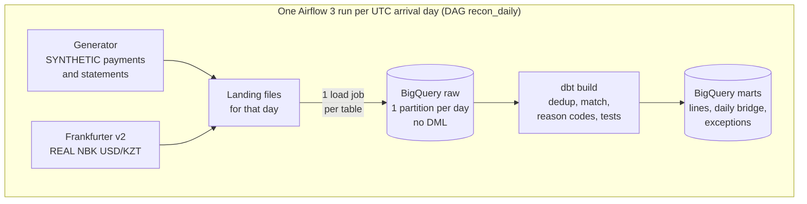
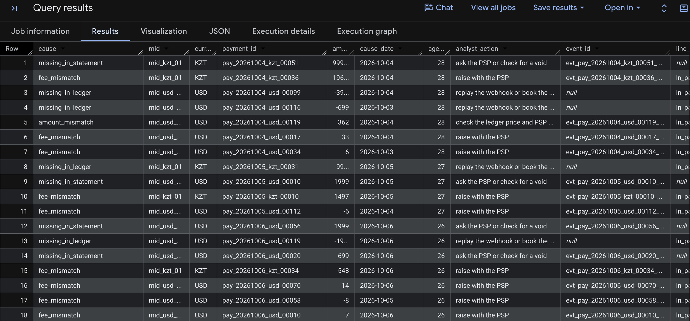
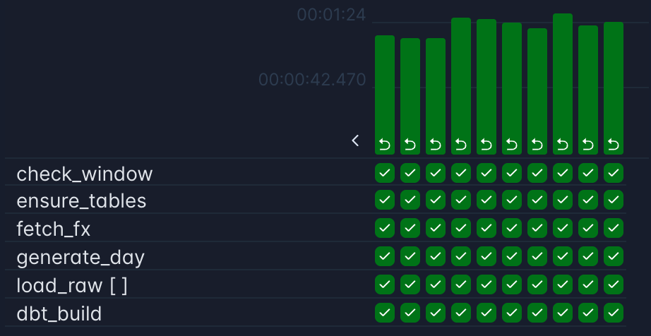

# Two Ledgers (`ledger-vs-statement`)

<!--
FILL: How to use this skeleton. Delete this comment before publishing.

Markers
1. A FILL comment (like this one) tells you what to write. GitHub does not render it. Delete each one when its section is true.
2. [WRITE: ...] marks a sentence or paragraph that you write in your own words.
3. Value placeholders: [D] [P] [R] [M] [U] [K] [W] [C] [X] [Y] [E] [A] [N] [s] [sha] [date] [first] [last] [result] [status] [observed].
   Copy values only from files your own run wrote: docs/evidence/2026-11-02/*.json, docs/testing.md and the ADR files.
   Never estimate, round up, or reuse a number from a planning document.

Rules
4. A results row with no measured value is deleted, never left as a placeholder.
5. The tables, lists and commands below were drafted from the plan. Before publishing, check every row against the code. Fix or delete any row that is not true.
6. Words to use: "learning project", "seeded self-test (synthetic)", "settled amount differs", "three dates (arrival, booking, accounting)", "reprocess", "backfill", "clear", "no DML".
   Words never to use: "production" (allowed only inside "What this does not prove"), "production-grade", "scalable", "real-time", "accuracy", "precision", "recall", "detection rate", "partial capture", "bitemporal".
   No em dashes. No word from the private banned-word list.
7. AI agents: never replace a [WRITE: ...] marker or a value placeholder. You may fix Markdown, links and table syntax when asked.

Cut-order items change these sections (only the items you applied):
- Item 1, no scripts/fx_report.py: delete row N3, the section "N3: real NBK weekend gap", the "Cross-check" row in "Real exchange rates", and every nbk_rss mention.
- Item 2, no warn tests: delete warn_exception_share_7d and warn_fx_restated from "Tests and data quality".
- Item 3, load loop: in "How a run works", load_raw is one task that loops over the 3 tables.
- Item 4, shorter history: change the dates in "Results and how they were measured" and in "Run it in full".
- Item 5, no exceptions view: replace fct_recon_exceptions with the saved query dbt/analyses/exceptions_queue.sql in "Data model" and in the diagram.
- Item 6, no fetch task: in "How a run works", fetch_fx is gone; FX comes from a committed, hand-fetched file in landing/fx/ (still real).
- Item 7, no fee checks: delete fee_mismatch from "Reason codes" and "Planted defects and benign behaviours", and the fee wording in the data model and tests.

If gate G1 failed (no recon_daily run went green end to end):
- Add this line under the banner: "Airflow DAG: in progress. The numbers below come from host runs (make days, make dbt-build)."
- N1 starts "Re-ran [D] days from the command line:" and keeps the rest of its wording.

Before publishing (build plan steps S10.1 and S10.4)
1. Copy the command in step 3 somewhere outside this file.
2. Delete every FILL comment, including this one.
3. Run:  grep -nE '<!--|\[WRITE|\[[A-Za-z]{1,8}\]([^(]|$)' README.md
   It must print nothing.
4. Open the README on GitHub in a private window. The diagram renders, and every link and image works.
-->

Does yesterday's revenue match what the payment provider settled, per merchant account? A daily Airflow 3 + dbt pipeline on the BigQuery sandbox that reconciles a synthetic subscription business's revenue ledger with per-MID settlement statements and explains every difference to the minor unit.

Learning project, built 1-2 Nov 2026 · Payments: SYNTHETIC (seeded generator) · FX: REAL (National Bank of Kazakhstan rates via Frankfurter) · BigQuery sandbox, Airflow 3.3.2, dbt-core 1.12.6 · $0

<!--
FILL: Keep the banner true.
- If you built on other days, change "built 1-2 Nov 2026".
- After later tags, write "v1.0 built 1-2 Nov 2026, updated [date]".
- Add the CI badge in front of the banner only in v1.2 (U2), when CI exists.
-->

<!--
FILL: Problem, 2-3 sentences, your words, no company names. Define MID (merchant account) and PSP (payment service provider) on first use. Cover:
1. Who needs the answer: finance, every morning.
2. Why the two ledgers disagree even when nothing is wrong: the warehouse books revenue from payment webhooks by UTC date, while each MID books the sale on its own accounting date and settles it 1-2 days later, with fees.
3. The real problems hidden in that noise: duplicated or lost webhooks, statement lines that never arrive, settled amounts that differ, fees outside the contract.
-->
**Problem.** [WRITE: the problem in 2-3 sentences]

<!--
FILL: What this does, 2 sentences, your words. Cover:
1. Each daily Airflow run loads exactly one arrival day into BigQuery: one load job per table, no DML.
2. dbt matches every payment to its statement line, gives each line one status and dated reason codes, and fails the run if any MID-day has a single unexplained minor unit.
-->
**What this does.** [WRITE: 2 sentences]

<!-- FILL: The diagram has 7 boxes (the outer box counts). Keep it at 8 or fewer. Update it if cut-order item 5 or 6 applied. -->


<!--
FILL: Results rules. This table is the headline of the repo.
- Copy every value from docs/evidence/2026-11-02/summary.json (written by make results). The caption values (seed, window, as_of, git SHA) come from the same file.
- Delete a row if its value was not measured. A published row never holds a placeholder.
- N1: use it only if make compare exited 0 on the final run. If the final compare was not all identical, show the real counts and link the failure-log entry, or delete the row. Never round up.
- N2: use it only if [U] is 0 and the latest run's assert_recon_decomposition_closes passed. Keep the mutation sentence only after the mutation check ran. The first [K] is the number of mutations that turned a test red and the second is the number applied, both from docs/testing.md. They are equal only if every mutation went red.
- N3: delete the row if make fx-report did not run before publishing.
- The seeded self-test never goes in this table. From v1.1 it has its own section (see docs/roadmap.md, U1).
- Never put bytes, cost, money amounts, accuracy, precision or recall in this table.
-->
**Results.** Measured on [date], window [first]..[last], seed [s], as of [A], commit [sha]. Source: [`docs/evidence/2026-11-02/summary.json`](docs/evidence/2026-11-02/summary.json).

| # | What was measured | Reproduce (in this order) |
|---|---|---|
| N1 | Reprocessed [D] days and re-ran 1 older day out of order: [P] of [P] partitions identical ([R] rows fingerprinted). | `make snapshot`, `make reprocess`, `make clear-day`, `make snapshot`, `make compare` ([steps](#n1-rerun-proof)) |
| N2 | [M] MID-days reconciled with [U] minor units unexplained: each MID-day's revenue-minus-statement gap equals the sum of its dated reason codes, computed two independent ways. [K] of [K] deliberate code mutations turned a test red. | `make results` ([query](#n2-cross-ledger-identity)) |
| N3 | Real NBK rates: on [W] of [C] weekend and holiday days, carrying the last weekday rate forward differed from NBK's own published rate by up to [X] KZT per USD ([Y] bps); weekday rates agreed exactly on [E] of [E] days. | `make fx-report` ([method](#n3-real-nbk-weekend-gap)) |

<!--
FILL: One screenshot of the outcome: the exceptions queue (run dbt/analyses/exceptions_queue.sql in the BigQuery console). Crop it so no project id shows. Save it as docs/img/exceptions_queue.png. If you have no screenshot when you publish, delete the image line.
-->


**Quickstart.** Needs Docker Desktop, uv, a BigQuery sandbox project with its key at `keys/sa.json`, and your project id in `.env`. Full steps: [Run it in full](#run-it-in-full).

<!--
FILL: Test these three commands from a clean clone (build plan step S10.3). make unpause works only after the scheduler has parsed the DAG. If it fails right after make up, wait until recon_daily shows in the UI, run it again, and add one short line here that says so.
-->
```bash
make setup     # host venv, dbt packages, local folders, .env from .env.example (edit it once)
make up        # build the image and start Airflow on http://localhost:8083
make unpause   # the scheduler runs the latest complete UTC day
```

Links: [Design](docs/design.md) · [Defect catalog](docs/specs/data_and_generator.md#defect-catalog) · [Decisions (ADRs)](docs/adr/README.md) · [Evidence](docs/evidence/2026-11-02/) · [Mutation check](docs/testing.md) · [Failure log](docs/failure_log.md) · [Operations runbook](docs/specs/airflow_and_docker.md#operations-runbook) · [Roadmap](docs/roadmap.md) · [Concepts and glossary](docs/learning/concepts.md) · [Build plan](docs/build_plan.md)

---

## Why this exists

<!--
FILL: 2-4 bullets, generic wording, your words. Map the project to questions that any subscription business with card payments has:
- Does the revenue in the warehouse match what the payment provider settled, per merchant account and day?
- Are duplicated or lost webhooks changing booked revenue?
- Which differences are only timing (cut-offs, settlement lags) and which need an analyst today?
- Are the fees inside the contract?
Do not describe or name any real company.
-->
- [WRITE: bullet 1]
- [WRITE: bullet 2]
- [WRITE: bullet 3]

## Data

<!-- FILL: Check every fact in this section against src/recon/world.toml, dbt/seeds/mids.csv and docs/specs/data_and_generator.md. Run the git log command below and keep the sentence "The defect catalog was committed before any matcher SQL" only if its output shows that order. -->

### Synthetic payments

| Item | v1.0 |
|---|---|
| Business | a small subscription business sells 1-, 4- and 12-week plans (`p1w`, `p4w`, `p12w`) through one payment service provider (PSP), `psp_alpha`, on two merchant accounts (MIDs) |
| Prices, plan mix, volumes | illustrative assumptions, set in `src/recon/world.toml`; about 200 payments a day across both MIDs (a design parameter) |
| Ledger side | one webhook per captured payment, sometimes delivered more than once; the warehouse books revenue by the UTC date of the capture |
| Statement side | one statement file per MID per arrival day; one line per sale with gross, fee and net in minor units; a line arrives 1 or 2 days after its accounting date |
| Statement layout | modelled on the public [Adyen settlement details report](https://docs.adyen.com/reporting/settlement-reconciliation/transaction-level/settlement-details-report/) and [Stripe payout reconciliation report](https://docs.stripe.com/reports/payout-reconciliation) docs; no data from either is used |
| Generator | `src/recon/generator.py`, standard-library Python, version 1.0.0; a pure function of (seed, day number, MID, purpose); only `random.Random.random()`; money in integer minor units; byte-identical files for the same inputs (a golden-hash pytest); frozen at tag `g1-freeze` |
| Ids | readable and deterministic, for example `pay_20261025_kzt_00042`; no personal data anywhere |
| Labels | every synthetic row has `is_synthetic = true`; table descriptions start with "SYNTHETIC:"; table label `data_origin=synthetic` |

Merchant accounts (`dbt/seeds/mids.csv`). These are contract terms that both the merchant and the PSP know.

| MID | Charges and settles in | Accounting day uses | Max settlement lag | Fee | Fee tolerance per line |
|---|---|---|---|---|---|
| `mid_usd_01` | USD | UTC-5 | 2 days | 290 bps + 30 cents | 10 bps, at least 5 cents |
| `mid_kzt_01` | KZT | UTC+5 | 2 days | 250 bps | 10 bps, at least 500 tiyn |

### Planted defects and benign behaviours

The defect catalog was committed before any matcher SQL. Rates, rules and the answer-key format are in the [Defect catalog](docs/specs/data_and_generator.md#defect-catalog). To check the commit order:

```bash
git log --reverse --date=iso --format='%ad %h %s' -- docs/specs/data_and_generator.md dbt/models/marts/fct_recon_lines.sql
```

| Id | Class | Expected outcome |
|---|---|---|
| D1 | `webhook_redelivery` | removed by dedup and counted in `copies_received`; no exception |
| D2 | `missing_in_statement` | `in_transit` until the due date, then exception `missing_in_statement` |
| D3 | `missing_in_ledger` | exception `missing_in_ledger` |
| D4 | `amount_mismatch` (the settled amount differs) | exception `amount_mismatch` |
| D5 | `fee_overcharge` | exception `fee_mismatch` when the overcharge is above the tolerance |
| B1 | `cutoff_shift` (benign) | `matched` with `date_shift = timing_cutoff` |
| B2 | `settlement_lag` (benign) | `in_transit` while waiting, then `matched` |
| B3 | `fee_noise` (benign) | inside the tolerance; rare designed spikes cross it on purpose |

The answer key (`landing/_truth/booking_date=YYYY-MM-DD.ndjson`) is gitignored and never loaded into BigQuery.

### Real exchange rates

| Item | v1.0 |
|---|---|
| Source | [Frankfurter v2](https://frankfurter.dev/), provider pinned to `nbk` (National Bank of Kazakhstan); never blended rates |
| Request | `https://api.frankfurter.dev/v2/rates?providers=nbk&base=USD&quotes=KZT&from=<R-6>&to=<R>`, once per run date R; never for today or a later date |
| Stored as | published: KZT per 1 USD, the exact digits as text in `rate_text`; cast to NUMERIC only in dbt; floats never touch a rate |
| Landing | `landing/fx/provider=nbk/arrival_date=R.json` plus `.meta.json` (url, fetched_at, http_status, sha256); committed to git; a landed day is never fetched again |
| Weekends and holidays | the last published rate is carried forward. This is a project convention, not NBK's official rate for that day |
| Checks | a carry-forward longer than 5 days fails the build; every rate must be between 300 and 700 KZT per USD; a rate whose text changes between fetches raises a warning |
| Used for | USD reporting columns only, converted once per MID-day; the reconciliation never converts currency in v1.0 |
| Cross-check (N3) | NBK's own daily feed, `https://nationalbank.kz/rss/get_rates.cfm?fdate=DD.MM.YYYY`, saved to `landing/fx/provider=nbk_rss/` |
| Labels | `raw.fx_rates` has a description starting "REAL:" and the label `data_origin=real` |

## Architecture

### Runtime

- Airflow 3.3.2 in Docker: image `ledger-vs-statement-airflow:3.3.2`, built `FROM apache/airflow:3.3.2`, LocalExecutor, Postgres 18 for Airflow's metadata, UI on port 8083.
- dbt-core 1.12.6, dbt-bigquery 1.12.1 and dbt-core-experimental-parser 2.0.8 live in their own venv at `/opt/airflow/dbt_venv`. Nothing is installed into Airflow's own environment, because dbt-bigquery needs google-cloud-storage below 3.2 and dbt-core needs pathspec below 1.1, while Airflow 3.3.2's constraints pin 3.14.1 and 1.1.1.
- On the host: a uv project pinned to Python 3.13 (the image also runs 3.13), with the same dbt pins, for development builds and scripts. Nothing calls a `dbt` binary from PATH.
- Credentials: a service-account key at `keys/sa.json`, gitignored and mounted read-only. dbt reads it through `DBT_KEYFILE`; Airflow reads it through the `google_cloud_default` connection, defined by an environment variable.
- Datasets, all in the US multi-region: `raw` and `analytics` (written by Airflow), `raw_dev` and `analytics_dev` (host development), `probe` (G0 probes and the smoke DAG).

### Data model

<!-- FILL: Check every row against dbt/models/**/_*.yml and the schema JSON files. -->

Raw tables (dataset `raw`; host runs use `raw_dev`):

| Table | One row per | Partition | Cluster | Written by |
|---|---|---|---|---|
| `raw.payment_events` | webhook delivery that arrived on `_arrival_date` | `_arrival_date` | `mid` | one `WRITE_TRUNCATE` load job per day into `payment_events$YYYYMMDD` |
| `raw.settlement_lines` | line of a per-MID statement file that arrived on `_arrival_date` | `_arrival_date` | `mid` | one `WRITE_TRUNCATE` load job per day |
| `raw.fx_rates` | rate observation returned by the fetch made for `_arrival_date` | `_arrival_date` | `provider` | one `WRITE_TRUNCATE` load job per day |

dbt models (dataset `analytics`; host builds use `analytics_dev`):

| Model | Layer | One row per | Key | Materialized | Partition, cluster | Tests |
|---|---|---|---|---|---|---|
| `stg_recon__as_of` | staging | the whole build (a single row: `as_of_date`, `scope_start`) | none | view | none | not_null on both columns |
| `stg_psp__payment_events` | staging | `event_id` (first delivery kept) | `event_id` | view | none | unique and not_null `event_id`; accepted_values `event_type`; relationships `mid` to `mids` |
| `stg_psp__settlement_lines` | staging | `line_id` | `line_id` | view | none | unique and not_null `line_id`; not_null `payment_id`; accepted_values `record_type`; `net_minor = gross_minor - fee_minor`; relationships `mid` to `mids` |
| `stg_fx__rates` | staging | (provider, base, quote, rate_date), first-seen value | the same four columns | view | none | unique combination; not_null `rate`; range 300 to 700 for KZT |
| `int_ledger__captures` | intermediate | `payment_id` | `payment_id` | view | none | unique and not_null `payment_id`; not_null booking, expected accounting and due dates; unit test UT1 |
| `int_fx__usd_rates_daily` | intermediate | (currency, day) | the same two columns | view | none | unique combination; not_null `units_per_usd` and `rate_date`; `carry_days` from 0 to 5 |
| `fct_recon_lines` | mart | `payment_id` seen on either side | `payment_id` | table | `recon_date`, `mid` | unique and not_null `payment_id`; not_null `recon_date`, `match_status`, `primary_reason`, `as_of_date`; accepted_values `match_status`; relationships `primary_reason` to `reason_codes`; unit test UT2 |
| `fct_recon_exceptions` | mart | (`payment_id`, `cause`) | the same two columns | view | none | unique combination; not_null `amount_minor`; relationships `cause` to `reason_codes` |
| `fct_recon_daily` | mart | (`mid`, `currency`, `recon_date`) | the same three columns | table, enforced contract | `recon_date`, `mid` | unique combination; contract with not_null on `mid`, `currency`, `recon_date`, `as_of_date`, `unexplained_minor` |

Seeds: `mids` (contract terms per MID), `currencies` (minor units per major unit), `reason_codes` (below). Singular tests are listed in [Tests and data quality](#tests-and-data-quality).

### Reason codes

From `dbt/seeds/reason_codes.csv`. Each line in `fct_recon_lines` gets exactly one `match_status` and one `primary_reason`. `fct_recon_exceptions` has one row per line and cause, so a line with two problems shows twice, with two amounts.

| Code | Category | Meaning | Analyst action |
|---|---|---|---|
| `missing_in_statement` | exception | ledger line with no statement line by its due date | ask the PSP or check for a void |
| `missing_in_ledger` | exception | settled by the PSP, never booked (lost webhook) | replay the webhook or book the revenue |
| `amount_mismatch` | exception | settled gross differs from the booked amount | check the ledger price and PSP adjustments |
| `fee_mismatch` | exception | fee outside the contracted tolerance | raise with the PSP |
| `date_mismatch` | exception | accounting date not explained by the MID's cut-off | check the PSP's cut-off |
| `in_transit` | explained | ledger line waiting for its statement, before the due date | wait |
| `timing_cutoff` | explained | booked on another accounting day because of the MID's cut-off | none |
| `before_scope` | explained | one-sided line dated before the oldest loaded day | none |
| `matched` | matched | both sides present, amounts equal, fee within tolerance, date explained | none |

### How a run works

<!--
FILL: 2-3 sentences, your words. Cover: one run owns one UTC arrival day; the data interval tells the run which day; each raw table gets exactly one partition replaced; dbt rebuilds the marts from all loaded days and stamps every row with as_of_date.
-->
[WRITE: how one run works, in 2-3 sentences]

| Task | What it does | Safe to rerun because |
|---|---|---|
| `check_window` | reads the run's data interval; checks it is exactly one UTC day; checks `RECON_WORLD_START <= R`, `R` before today (UTC), and `R` at most 45 days old; returns `R` | it is a pure check |
| `ensure_tables` | creates the `raw` dataset and the 3 raw tables from the schema JSON files if they are missing | idempotent DDL through the API |
| `generate_day` | writes the synthetic files that arrive on `R`, and the local answer key | a pure function: byte-identical files |
| `fetch_fx` | fetches NBK USD/KZT for R-6..R and lands the response once | a landed day is never fetched again |
| `load_raw` (3 mapped tasks) | one `WRITE_TRUNCATE` load job per table into `<table>$YYYYMMDD`, or a partition delete when the day has no rows; checks that the job wrote exactly the rows landed | each partition is replaced whole |
| `dbt_build` | `dbt build --exclude-resource-type unit_test` in pool `dbt_serial` (1 slot), with artifacts in `runs/dbt/<R>/` | a full rebuild of views and small tables from raw |

Rules the DAG follows:
- Schedule `CronDataIntervalTimetable("0 0 * * *", timezone="UTC")`, catchup off, `max_active_runs=1`. The run for day R covers [R 00:00, R+1 00:00) UTC and starts just after R+1 00:00 UTC.
- Never `"@daily"`: in Airflow 3 it gives a run with an empty data interval.
- Exact days only through one-day backfills. `airflow dags trigger -l D` processes yesterday relative to now, not D.
- The only wall-clock read is in `check_window`, and it never shapes data.
- `as_of_date` is the latest loaded arrival date and is stored on every mart row, so rerunning an old day never rolls the marts back.
- Late data: the generator recomputes the last 5 booking days, so late deliveries land in the right arrival file. A ledger line without a statement line stays `in_transit` until its due date.
- An empty day deletes its partition. That is a table operation, not DML.
- The 1-slot pool `dbt_serial` keeps a scheduled run and a backfill run from building dbt at the same time.

Three dates:

| Date | Meaning | Column |
|---|---|---|
| Arrival date | the UTC day a webhook or a statement file reached us; one run owns one arrival date | `_arrival_date` (the raw partition) |
| Booking date | our revenue day: the capture time's UTC date | `int_ledger__captures.booking_date` |
| Accounting date | the PSP's day for the sale: the capture time shifted by the MID's fixed UTC offset | `settlement_lines.accounting_date` |

<!-- FILL: Screenshot of the Airflow grid after the backfill and the reprocess, all green, saved as docs/img/airflow_grid.png. Delete the image line if you have none. -->


### One payment, end to end (synthetic example)

`pay_20261020_kzt_00042`: 999000 tiyn (9,990.00 KZT), captured 2026-10-20 20:15:07 UTC on `mid_kzt_01`.

| When (UTC) | What happens | What the marts show |
|---|---|---|
| 2026-10-20 20:15:30 | the first webhook arrives | booking date 2026-10-20 |
| 2026-10-21 02:10 | a redelivery arrives | dedup keeps the first delivery; `copies_received = 2` |
| accounting | 20:15 UTC plus 5 hours is 01:15 on 2026-10-21, so the PSP books the sale on 2026-10-21 (B1) | due date 2026-10-24: accounting date + 2 days max lag + 1 day grace |
| 2026-10-22 | the statement line arrives in `stmt_mid_kzt_01_20261022` | as of 2026-10-20 and 2026-10-21: `in_transit`; as of 2026-10-22 or later: `matched` with `date_shift = timing_cutoff` |
| daily bridge | timing component +999000 on 2026-10-20 and -999000 on 2026-10-21 | the timing difference nets to zero over the two days |

## Tests and data quality

<!--
FILL: 2-3 sentences, your words. Cover: why the identity is not a tautology (top-down and bottom-up come from different models, so a matcher that loses, duplicates or misdates a line turns it red), and what it does not check (whether each line got the right reason).
Write "fails when" only about tests that the mutation check turned red.
Keep "seen red before the logic existed" only if the "Planned red runs" table in docs/failure_log.md records those red runs.
-->
[WRITE: the testing strategy in 2-3 sentences]

### Three kinds of evidence

| Kind | Question it answers | Evidence | What it cannot show |
|---|---|---|---|
| Integrity | Does the matcher lose, duplicate or misdate money? | the cross-ledger identity and the preservation test (both error level), plus unique and not_null tests at every change of grain | whether each line got the right reason |
| Logic | Are the rules right on hand-made cases? | unit tests UT1 and UT2, written first and seen red before the logic existed (UT3 and UT4 come in v1.1) | cases nobody wrote down |
| Planted data | Does it find what was planted? | the seeded self-test, from v1.1 (`make eval`) | behaviour on real data; the same author planted the defects and wrote the matcher |

### The cross-ledger identity

For every (`mid`, `currency`, `recon_date`):
- Top-down: `gap_minor` = booked gross by booking date (from `int_ledger__captures`) minus statement gross by accounting date (from `stg_psp__settlement_lines`). This path never touches the matcher.
- Bottom-up: the sum of 7 dated components built from `fct_recon_lines`: `timing_cutoff`, `date_mismatch`, `amount_mismatch`, `in_transit`, `missing_in_statement`, `missing_in_ledger`, `before_scope`.
- `unexplained_minor` = `gap_minor` minus the components. It must be 0 on every row.

How each line contributes (L = booked amount on booking date a, S = statement gross on accounting date b, both in settlement-currency minor units):

| Line | Component |
|---|---|
| matched, a = b | `amount_mismatch`: L - S on b (when not 0) |
| matched, a different from b | `timing_cutoff` or `date_mismatch`: +L on a and -L on b; plus `amount_mismatch`: L - S on b |
| ledger only | `in_transit`, `missing_in_statement` or `before_scope`: +L on a |
| statement only | `missing_in_ledger` or `before_scope`: -S on b |

Fees change net and payout, not gross. They have their own columns and never enter the gross identity.

### Singular tests

| Test | Severity | Checks that |
|---|---|---|
| `assert_recon_decomposition_closes` | error | every `fct_recon_daily` row has `unexplained_minor = 0` |
| `assert_no_money_lost_between_layers` | error | per MID, count and sums on each side of `fct_recon_lines` equal their input models (this also catches a dropped same-day matched line, which adds 0 to the gap) |
| `assert_redeliveries_identical` | error | all deliveries of one `event_id` carry the same `payment_id`, `mid`, `amount_minor`, `currency`, `event_ts` and `event_type` (dedup keeps the first delivery, which is safe only then) |
| `assert_arrival_days_complete` | error | every day in the window has payment events, and every MID has statement lines on every day after the first (a missing file is an incident, not a pile of exceptions) |
| `warn_exception_share_7d` | warn | per MID, the rolling 7-day break share stays at or below 2%, or there are fewer than 5 exceptions (a business gate: exceptions are output, not run failures) |
| `warn_fx_restated` | warn | no rate date has two different published texts across fetches |

No test is tautological: no uniqueness test is filtered by a `ROW_NUMBER` rank, and no identity is computed from its own residual.

### Unit tests

| Id | Model | Case | Version |
|---|---|---|---|
| UT1 `ut_captures_cutoff_both_directions` | `int_ledger__captures` | captures on both sides of each MID's cut-off, including one second before it and exactly at it: expected accounting date and due date | v1.0 |
| UT2 `ut_lines_status_and_date_shift` | `fct_recon_lines` | `in_transit` against `missing_in_statement` (the due date is inclusive), `timing_cutoff` against `date_mismatch`, statement-only and `before_scope` lines | v1.0 |
| UT3 `ut_events_dedup_first_delivery` | `stg_psp__payment_events` | earliest delivery kept, a tie broken by `delivery_id`, a delivery after as_of excluded | v1.1 |
| UT4 `ut_lines_fee_boundary_and_two_causes` | `fct_recon_lines` | the inclusive fee-tolerance boundary, one line with two causes, half-up fee rounding | v1.1 |

Unit tests run on the host only (`make dbt-build` or `make dbt-unit`). The DAG excludes them, and CI has no warehouse to run them.

### Mutation check

Each mutation was applied on a scratch branch; `dbt run` and then `dbt test` were run on the dev datasets; every red test was recorded and the change was reverted. Full record: [`docs/testing.md`](docs/testing.md).

<!-- FILL: Copy the observed column from docs/testing.md. If a mutation stayed green, write that, and add a failure-log entry. If the mutation check did not run, delete this whole section and the mutation sentence in N2. -->

| # | Mutation | Expected red | Observed red |
|---|---|---|---|
| 1 | `FULL OUTER JOIN` changed to `INNER JOIN` in `fct_recon_lines` | `assert_recon_decomposition_closes`, `assert_no_money_lost_between_layers` | [observed] |
| 2 | `as_of_date < due_date` changed to `<=` | UT2 | [observed] |
| 3 | `QUALIFY` removed from `stg_psp__payment_events` | unique `event_id`, unique `payment_id` | [observed] |
| 4 | the statement-side `record_type = 'SALE'` filter moved after the join | `assert_recon_decomposition_closes`, `assert_no_money_lost_between_layers` | [observed] |

### Python tests

`tests/test_generator.py` checks: a golden hash of one emitted day; another seed gives different data; every row's `_arrival_date` equals the run date, and so does `DATE(delivered_ts)` for every webhook delivery; every settled payment appears in exactly one statement file over 10 days; rows match the schema JSON; class counts over 7 days stay inside loose bounds.

## Cost and sandbox constraints

### Platform constraints (G0 probes)

The BigQuery sandbox has no billing account. It refuses DML (INSERT, UPDATE, DELETE, MERGE), streaming inserts, the Data Transfer Service (so no scheduled queries) and Cloud Storage. Every table, view and partition expires after 60 days, and storage is a lifetime 10 GiB that deleting data does not give back. Setup details: [`docs/specs/bigquery_sandbox_and_costs.md`](docs/specs/bigquery_sandbox_and_costs.md).

| Id | What it checks | Pass means | Result (2026-11-01) |
|---|---|---|---|
| S1.1 | personal account, "No organization", new project | SANDBOX badge, no billing account | PASS |
| S1.2 | service account `lvs-pipeline` and its JSON key | key saved; `git check-ignore keys/sa.json` prints the path | PASS |
| S1.3 | host venv and dbt | Core 1.12.6 and bigquery 1.12.1; `uv run dbt debug` passes | PASS |
| P1 | `CREATE OR REPLACE TABLE` and a view | both succeed | PASS |
| P2 | one `INSERT` | refused with "DML queries are not allowed in the free tier" | PASS |
| P3 | two `WRITE_TRUNCATE` loads into `probe.raw_pay$<yesterday>`, then one load into another day | yesterday holds only the second file's row; the other day is untouched | PASS |
| P4 | a row dated the day before, loaded into `$<yesterday>` | refused: the row does not match the partition | PASS |
| P5 | `delete_table` on `probe.raw_pay$<yesterday>` | that day has 0 rows | PASS |
| P6 | dataset and table expiration settings | 60 days; no table-level expiration on the partitioned table | PASS |
| P7 | `probe.__TABLES__` and `region-us.INFORMATION_SCHEMA.TABLE_STORAGE` | at least one is readable | PASS: `__TABLES__` readable |
| F1 | one Frankfurter request | HTTP 200, a flat list of rows, weekdays only | PASS |
| P8 (optional) | dbt `insert_overwrite` with `copy_partitions: true`, run twice | "Copying table(s)" in the dbt log; no `merge into` or `insert into` | not run |

The DML refusal, exactly as P2 printed it (first line):

> 403 Billing has not been enabled for this project. Enable billing at https://console.cloud.google.com/billing. DML queries are not allowed in the free tier. Set up a billing account to remove this restriction.

What the results decided: [WRITE: 1-2 sentences: the write path and the authentication you chose, from ADR-0001]

Not probed: loading a partition dated 70 days back. The docs say it expires at once, and the 45-day guard in `check_window` prevents it.

### Cost and storage

- $0. No billing account is linked, so nothing can be charged.
- Every query is capped at 1,000,000,000 bytes (1 GB) with `maximum_bytes_billed`, in the dbt profile and in every Python query.
- Staging and intermediate models are views, which store nothing. Only `fct_recon_lines` and `fct_recon_daily` are tables.
- How Google meters the lifetime 10 GiB is not documented, so the project assumes every byte written counts and caps itself at 1 GiB written. v1.3 adds a bytes-written ledger with a stop at 8 GiB.
- No run writes a date older than 45 days, well inside the 60-day expiry.
- Never a second sandbox project to reset the quota: the Google Cloud Terms forbid it. Plan B is the GCP Free Trial in a new project ([ADR-0001](docs/adr/0001-warehouse-bigquery-sandbox.md)).
- Bytes are not a result here: each query is billed at least 10 MB, which dominates at this size.

<!-- FILL: Copy from docs/evidence/2026-11-02/storage.json. Delete the line if make storage did not run. -->
Measured with `make storage` on [date]: [N] bytes stored across [N] tables ([`storage.json`](docs/evidence/2026-11-02/storage.json)).

## Design decisions

<!-- FILL: Copy each status from the ADR file. "Proposed" means a draft not yet rewritten in your words. Planned at v1.0: 0001 to 0003 Accepted, the rest Proposed. -->

Index: [`docs/adr/README.md`](docs/adr/README.md).

| ADR | Decision | Status |
|---|---|---|
| [0001 Warehouse](docs/adr/0001-warehouse-bigquery-sandbox.md) | BigQuery sandbox, no billing, a DML-free design; Plan B is the GCP Free Trial in a new project | [status] |
| [0002 Raw write path and time model](docs/adr/0002-raw-write-path-and-time-model.md) | one `WRITE_TRUNCATE` load job per table and arrival day into `table$YYYYMMDD`; three dates; marts as of the latest loaded arrival date | [status] |
| [0003 Reconciliation method](docs/adr/0003-reconciliation-method.md) | exact match on `payment_id` in INT64 minor units; one status per line; dated additive components; identity and preservation as error tests | [status] |
| [0004 FX policy](docs/adr/0004-fx-policy.md) | NBK via Frankfurter, stored as published, landed once and committed; the weekend carry-forward is a labelled convention | [status] |
| [0005 Orchestration and run semantics](docs/adr/0005-orchestration-and-run-semantics.md) | `CronDataIntervalTimetable` at 00:00 UTC; exact days only through one-day backfills; history loaded newest first; a 1-slot dbt pool | [status] |
| [0006 dbt runtime in Airflow](docs/adr/0006-dbt-runtime-in-airflow.md) | a BashOperator calling dbt in its own venv, with per-run target and log paths; Cosmos later | [status] |
| [0007 Evaluation and answer key](docs/adr/0007-evaluation-and-answer-key.md) | the answer key is never loaded; a seeded self-test with raw counts; a held-out world only after the matcher is tagged | [status] |
| [0008 Materialization and incremental](docs/adr/0008-materialization-and-incremental.md) | views and small full-rebuild tables in v1.0; one `copy_partitions` snapshot in v1.5 | [status] |
| [0009 Window and expiry](docs/adr/0009-window-and-expiry.md) | a 28-day world ending yesterday (UTC); a 45-day write guard; evidence committed so numbers outlive the expiry | [status] |
| [0010 Synthetic world design](docs/adr/0010-synthetic-world-design.md) | a standard-library generator, one random stream per purpose, files emitted by arrival date | [status] |

## Results and how they were measured

Every number on the first screen comes from `docs/evidence/2026-11-02/`, written by the commands below from my own run. `summary.json` records the seed, world start, window, as_of date and git SHA. The table under [Evidence files](#evidence-files) lists what each file holds.

<!-- FILL: Replace the dates below with the ones you actually used, if they changed. -->

### N1: rerun proof

| Symbol | Meaning |
|---|---|
| P | (table, partition) groups: the 3 raw tables per `_arrival_date`, and `fct_recon_lines` and `fct_recon_daily` per `recon_date`, inside the window |
| identical | the same `COUNT(*)`, the same `BIT_XOR` of `FARM_FINGERPRINT(TO_JSON_STRING(row))` and the same `BIGNUMERIC` sum of those fingerprints, before and after, with the same as_of date in both snapshots |
| D | logical dates in the `--reprocess-behavior completed` backfill |
| R | the sum of `COUNT(*)` over all groups |

XOR alone would cancel two identical rows, so COUNT and the sum are kept too. No column needs excluding: there are no wall-clock columns, and `fetched_at` is frozen in the landed meta file. Fingerprint SQL: [`scripts/prove_idempotency.py`](scripts/prove_idempotency.py).

Procedure, all inside one UTC day (after the next 00:00 UTC, a new scheduled run would legitimately change the marts):
1. Code frozen: the generator and the loader since tag `g1-freeze`, dbt since the last `dbt_build` rerun.
2. The 00:00 UTC scheduled run has finished and nothing is running. The DAG stays unpaused.
3. `make snapshot OUT=docs/evidence/2026-11-02/fp_before.json FROM=2026-10-03 TO=2026-11-01`
4. `make reprocess FROM=2026-10-26 TO=2026-11-01` (7 days, `--reprocess-behavior completed --max-active-runs 1`)
5. When all 7 runs are green: `make clear-day DAY=2026-10-14` (one older day, out of order)
6. When it is green: `make snapshot OUT=docs/evidence/2026-11-02/fp_after.json FROM=2026-10-03 TO=2026-11-01`
7. `make compare BEFORE=docs/evidence/2026-11-02/fp_before.json AFTER=docs/evidence/2026-11-02/fp_after.json` writes `compare.json` and exits non-zero on any changed group or a changed as_of date.

The window starts on 2026-10-03, one day before the world start, because a USD capture early on 2026-10-04 (UTC) has a 2026-10-03 accounting date.

### N2: cross-ledger identity

| Symbol | Meaning |
|---|---|
| M | rows of `analytics.fct_recon_daily` at its as_of date |
| U | `SUM(ABS(unexplained_minor))`; the claim is used only if U is 0 and the latest run's `assert_recon_decomposition_closes` passed |
| K | from [`docs/testing.md`](docs/testing.md): mutations that turned a test red, of mutations applied |

<!-- FILL: Keep this query identical to the one in scripts/results.py. -->
```sql
select count(*)                          as mid_days,
       sum(abs(unexplained_minor))       as abs_unexplained_minor,
       countif(unexplained_minor != 0)   as days_not_closing,
       min(recon_date)                   as first_day,
       max(recon_date)                   as last_day,
       max(as_of_date)                   as as_of
from `{project}.analytics.fct_recon_daily`
```

How the identity works: [The cross-ledger identity](#the-cross-ledger-identity).

### N3: real NBK weekend gap

Over the KZT days d from `scope_start` to as_of:

| Symbol | Meaning |
|---|---|
| C | days with no Frankfurter row dated d (weekends and holidays) |
| W | those days where the carried-forward rate differs from NBK's own feed for d |
| X | the largest absolute difference, in KZT per USD |
| Y | X divided by NBK's rate, times 10,000, in bps with 1 decimal |
| E | days with a Frankfurter row; all of them must equal NBK's feed exactly, or `make fx-report` exits non-zero |

Method: `scripts/fx_report.py` requests NBK's feed once per day (never for today or later, because the feed returns its latest rate for future dates), checks that the XML echoes the requested date and that USD is quoted per 1 unit, saves the XML to `landing/fx/provider=nbk_rss/`, parses rates with `Decimal`, and compares them with `analytics.int_fx__usd_rates_daily`. Output: `docs/evidence/2026-11-02/fx_report.json`.

### Evidence files

| File | Written by | Holds |
|---|---|---|
| `summary.json` | `make results` | N1, N2 and N3 with seed, world start, window, as_of and git SHA |
| `fp_before.json`, `fp_after.json` | `make snapshot` | fingerprints per (table, partition) and the as_of date |
| `compare.json` | `make compare` | the comparison behind N1 |
| `fx_report.json` | `make fx-report` | the comparison behind N3 |
| `storage.json` | `make storage` | stored bytes per dataset |

<!-- FILL: From v1.1 only, add a section "Seeded self-test (synthetic, not accuracy)" here, from the template under U1 in docs/roadmap.md. Never before v1.1, and never in the first-screen table. -->

## Limitations

<!-- FILL: Never describe v1.0 as reconciling "all" revenue of any business. Add any limitation you found while building. -->

- One PSP (`psp_alpha`) and two MIDs, each charging and settling in its own currency. FX feeds USD reporting columns only; the reconciliation never converts currency.
- Not reconciled in v1.0: refunds, chargebacks, reserves, payouts and bank arrival, presentment against settlement currency, cascades and approval rates, test transactions, app-store revenue, revenue recognition over the service period.
- Cut-offs are fixed UTC offsets. Settlement lags are calendar days, with no business days or holidays.
- Every MID is assumed to send statement lines every day. Statement batches with control totals come in v1.6.
- Matching is exact on `payment_id`. There is no second matching pass.
- The weekend FX carry-forward is a project convention, not NBK's official rate for that day.
- Sandbox tables and partitions expire after 60 days. The numbers survive in `docs/evidence/`.
- About 200 payments a day.

## What this does not prove

- Production experience. This is a learning project.
- Real PSP behaviour or real statement file formats.
- Detection quality on real data.
- Behaviour at scale: the data is about 200 payments a day.
- Any fact about any real company.
- That every label is right. The identity and the preservation test show that no minor unit is lost, duplicated or put on the wrong day. They do not show that each line got the right reason. Unit tests and, from v1.1, the seeded self-test cover the labels, within their limits.

## Roadmap: what I would do next

<!-- FILL: Keep this short. The details, and the concept each step teaches, are in docs/roadmap.md. Mark each tag as it ships. -->
[WRITE: 1-2 sentences in your words: what you would do next, and why]

Next, in a fixed order. Each step ends with a git tag.

| Tag | Upgrade |
|---|---|
| v1.1 | unit tests UT3 and UT4, mutation 5, the seeded self-test (`make eval`), ADR-0004 to 0007 accepted |
| v1.2 | CI on GitHub Actions: ruff (AIR301, AIR302), pytest, a DAG import test, `dbt parse`, a secret check |
| v1.3 | proof hardening: a full-window reprocess, a negative control, a `raw_dev` against `raw` check, run records, a bytes-written ledger with an 8 GiB stop |
| v1.4 | a held-out world (a new seed and defects the matcher was not designed for), with the misses published |
| v1.5 | a point-in-time status snapshot with `insert_overwrite` and `copy_partitions`, and a settlement completeness curve |
| v1.6 | statement batches with control totals, and a planted late batch |
| v1.7 | a cross-currency MID (KZT presentment, USD settlement) with an FX component and a tolerance sweep |

Later: v1.x (a Postgres source extracted on a watermark, refunds and chargebacks, business-day calendars, a second matching pass, Cosmos, dbt docs on Pages, a DuckDB target), v2 lanes (app-store revenue, ad spend with recommend-only rules, event integrity, payments risk) and v3 (Terraform, the GCP Free Trial for MERGE and snapshots). Nothing on this list exists as a stub in the code. Full list: [`docs/roadmap.md`](docs/roadmap.md).

## How I used AI

<!--
FILL: Write this section yourself, in the first person, in your own words. Keep it true: leave out anything below that did not happen, and add anything that did. Points the plan expects, if they stayed true:
1. The planning documents (docs/design.md, docs/build_plan.md, docs/specs/, docs/learning/concepts.md, docs/roadmap.md and the ADR drafts) were drafted with an AI assistant before the build and reviewed by you. Each starts with a line saying so. An ADR is marked Accepted only after you rewrote it in your own words.
2. This README started from a skeleton drafted with AI: the headings, tables, command lists and fact lists. Say which parts you rewrote, and that you checked every row against the code. You wrote the prose.
3. Code an AI agent wrote and you reviewed: the boilerplate (Dockerfile, compose edits, Makefile, .gitignore, YAML column lists, argparse and IO wrappers, scripts/g0_probe.py, the schema JSON, later the CI YAML) and any core logic you asked it to write. Name the core parts. The agent explained each piece before writing it and walked you through every line after. Those commits say "written with AI, reviewed", so `git log --grep "written with AI"` lists them.
4. What you wrote yourself: list only the parts you actually wrote.
5. How you verified: pytest and dbt tests, the G0 probes, the mutation check (docs/testing.md), the rerun proof, and an explain-any-file drill without notes.
6. One honest example of something AI got wrong and how you caught it, if it happened. Link the failure-log entry.
7. The rules AI agents follow in this repo are in AGENTS.md.
-->
[WRITE: how I used AI, in my own words]

## Run it in full

### Prerequisites

<!-- FILL: Keep only the versions you actually ran. -->
- macOS or Linux with Docker Desktop (or Docker Engine) running, at least 6 GB of memory for Docker and at least 10 GB of free disk.
- uv (it installs Python 3.13 for the host tools), git and make.
- A personal Google account. A school or work account must pick an organization, whose policies can block service-account keys.
- Port 8083 free.
- No gcloud CLI and no credit card.

Built and tested with macOS 26 on Apple Silicon, Docker 29.7.2 and uv 0.13.1.

### Setup

<!-- FILL: If S1.2 failed and you used Application Default Credentials, replace steps 4 and 5 with the gcloud steps from docs/specs/bigquery_sandbox_and_costs.md. -->
1. Clone the repo:
   ```bash
   git clone https://github.com/bainazarseitek/ledger-vs-statement.git && cd ledger-vs-statement
   ```
2. In the Google Cloud console, with a personal account, create a project under "No organization". Open BigQuery and check that it shows the SANDBOX badge and that Billing shows no linked account. Screen-by-screen steps: [`docs/specs/bigquery_sandbox_and_costs.md`](docs/specs/bigquery_sandbox_and_costs.md).
3. In BigQuery, create a dataset named `probe` in the US multi-region. The probes and the smoke DAG write a few KB there.
4. In IAM, create the service account `lvs-pipeline` and grant it BigQuery Job User and BigQuery Data Editor on the project. Create a JSON key and save it as `keys/sa.json`.
5. Lock the key down and check that git ignores it:
   ```bash
   chmod 600 keys/sa.json
   git check-ignore keys/sa.json   # must print keys/sa.json
   ```
6. Create the host environment:
   ```bash
   make setup   # uv sync, uv run dbt deps, local folders, .env from .env.example if missing
   ```
7. Edit `.env`:

   | Variable | Set to | Why |
   |---|---|---|
   | `AIRFLOW_UID` | the output of `id -u` | the containers run as your user, so they can read `keys/sa.json` |
   | `GCP_PROJECT` | your sandbox project id | the only place the project id lives |
   | `RECON_SEED` | `20261101` | the seed of the published run |
   | `RECON_WORLD_START` | `2026-10-04`, or a later date (see the window rule below) | the first business day of the synthetic world |

   Never put `DBT_KEYFILE` or `GOOGLE_APPLICATION_CREDENTIALS` in `.env`. The Makefile and the compose file set them, and dbt 1.12 also reads `.env` from its working directory, where a wrong path would win in a manual run.
8. Run the G0 probes and create the raw tables:
   ```bash
   make probe      # prints PASS or FAIL per probe
   make bq-setup   # datasets and raw tables for raw and raw_dev
   ```

The window rule. The DAG accepts a run date R only if `RECON_WORLD_START <= R`, R is before today (UTC), and R is at most 45 days old. The published run used `RECON_WORLD_START=2026-10-04`. From 2026-11-19 (UTC) on, that date is more than 45 days old, so pick a new start: yesterday (UTC) minus 27 days gives 28 days of history ending yesterday. Example: on 2026-12-10 (UTC), yesterday is 2026-12-09, so set `RECON_WORLD_START=2026-11-12` and backfill `FROM=2026-11-12 TO=2026-12-08`. The synthetic payments depend only on the seed and the day number, so the same seed gives the same payments on the new dates. Only the real FX rates differ. If you already loaded another window, reset the datasets first: delete `raw` and `analytics` (and `raw_dev` and `analytics_dev` if you used them), then run `make bq-setup` again. Deleting gives no storage quota back. The full steps, including what to do if Airflow already has runs on the new dates, are under "Reset the datasets (moving the window)" in [`docs/specs/bigquery_sandbox_and_costs.md`](docs/specs/bigquery_sandbox_and_costs.md#reset-the-datasets-moving-the-window). After any change to `.env`, run `make down` and `make up` so the containers see it.

### Run

1. Start Docker Desktop and give it at least 6 GB of memory. Stop any other stack that uses port 8083.
2. Start Airflow:
   ```bash
   make up   # builds ledger-vs-statement-airflow:3.3.2 on first use, then starts the stack
   ```
   The first build needs access to github.com (the dbt parser downloads its wheel) and adds several hundred MB. `airflow-init` creates the pool `dbt_serial`. The UI is at http://localhost:8083 (user `airflow`, password `airflow`).
3. Check the setup:
   ```bash
   make doctor   # dbt binary and versions on the host, and the dbt_serial pool in Airflow
   make smoke    # optional: the manual DAG smoke_bigquery loads 1 row into probe.smoke and runs dbt debug
   ```
4. Run the latest complete day:
   ```bash
   make unpause   # with catchup off, the scheduler creates and runs yesterday (UTC)
   ```
   The `check_window` log shows `run_date=YYYY-MM-DD`.

### Backfill

A backfill creates runs for a range of dates. The DAG must be unpaused first.

```bash
make backfill-dry FROM=2026-10-04 TO=2026-10-30   # lists the runs it would create
make backfill FROM=2026-10-04 TO=2026-10-30       # the published history: world start to the day before the first scheduled run
```

- Both targets pass `--run-backwards --max-active-runs 1`. Newest first means every run sees a contiguous history from its own date to the latest loaded day.
- On a Mac, keep it on power with the lid open, and run `caffeinate -is` in another terminal while the backfill runs.
- To stop a backfill, cancel it from the backfill banner in the UI. The 3.3.2 CLI only has `backfill create`.

### Reprocess

To reprocess is to rerun days that already finished. To clear is to rerun the tasks of one existing run.

```bash
make reprocess FROM=2026-10-26 TO=2026-11-01   # passes --reprocess-behavior completed --max-active-runs 1
make clear-day DAY=2026-10-14                  # clears and reruns every task of that day's run
```

To prove that reprocessing changes nothing, follow [N1: rerun proof](#n1-rerun-proof).

### Develop on the host

The host writes only to `raw_dev` and `analytics_dev`, so it never disturbs the proof datasets.

```bash
make day DATE=2026-10-25                 # generate, fetch FX and load one day into raw_dev
make days FROM=2026-10-25 TO=2026-10-31  # the same for a range
make dbt-build                           # target dev: builds analytics_dev, with unit tests and data tests
make dbt-unit                            # unit tests only; their parents must exist, so run make dbt-build once first
```

Never call a bare `dbt`: another dbt on PATH (for example dbt v2) is a different program. The Makefile calls `uv run dbt`, and the containers call `/opt/airflow/dbt_venv/bin/dbt`.

### Measure

```bash
make results     # docs/evidence/<date>/summary.json
make fx-report   # docs/evidence/<date>/fx_report.json
make storage     # docs/evidence/<date>/storage.json
```

### Checks before a commit

```bash
make test    # pytest
make lint    # ruff
make check   # test and lint, and it fails if git tracks keys/ or .env
```

## Teardown

```bash
make pause                      # no new runs; running tasks finish
make down                       # stop the containers; Airflow metadata stays in the Postgres volume
docker compose down --volumes   # also delete the Airflow metadata volume
```

Then, when you are done with the project:
1. Optional: in the BigQuery console, delete the datasets `raw`, `raw_dev`, `analytics`, `analytics_dev` and `probe`. Deleting gives no lifetime storage quota back. If you leave them, the data in them expires by itself within about two months, but the datasets themselves stay until you delete them. If you may rebuild a fresh window later, you can leave them: "Reset the datasets (moving the window)" in [`docs/specs/bigquery_sandbox_and_costs.md`](docs/specs/bigquery_sandbox_and_costs.md#reset-the-datasets-moving-the-window) deletes the ones a rebuild needs.
2. In IAM, delete the key of `lvs-pipeline`.
3. Delete `keys/sa.json` on your machine.

## Troubleshooting

| Symptom | Likely cause | Fix |
|---|---|---|
| `make doctor` fails on the dbt version | another dbt on PATH | use `uv run dbt`, never a bare `dbt` |
| `check_window` fails with "No data interval: create exact days with a one-day backfill" | the run was created without a data interval (an API or asset run) | create the day with a one-day backfill |
| `check_window` fails on the date | the run date is before `RECON_WORLD_START`, today or later, or more than 45 days old | pick a date inside the window, or move `RECON_WORLD_START` (window rule above); never lift the guard |
| backfill runs stay queued | the DAG is paused, or the pool `dbt_serial` is missing | `make unpause`; in the scheduler container, `airflow pools get dbt_serial` |
| "Another backfill is running" | one backfill per DAG at a time | wait, or cancel it in the UI backfill banner |
| `fetch_fx` fails after its retries | Frankfurter is slow or down | clear the task later, or land a hand-fetched JSON at the same path |
| `load_raw` fails | a row in the wrong partition, or a schema mismatch | fix the generator or the schema JSON, then clear `load_raw` for that day |
| `dbt_build` fails on an error test | a real reconciliation break or a bug | read the failing test's compiled SQL under `runs/dbt/<run date>/target/`, fix it, then clear only `dbt_build` (`airflow tasks clear recon_daily -s D -e D -t dbt_build -y` in the scheduler) |
| `assert_arrival_days_complete` fails | a day or a statement file is missing | load the missing day with a one-day backfill, then clear the latest `dbt_build` |
| 403 "DML queries are not allowed in the free tier" | a DML statement slipped in | change the materialization: no `merge`, no `insert_overwrite` without `copy_partitions`, no snapshots |
| RESOURCE_EXHAUSTED or a free-storage quota error on a load or a table build | the lifetime 10 GiB is used up | stop; follow Plan B in ADR-0001; never a second sandbox project |
| runs stall overnight | the Mac slept | wake it; the scheduler continues |
| `make up` fails on port 8083 | another stack uses the port | stop it with `docker compose down` in its folder |
| a key was committed or pushed | | delete the key in IAM at once, create a new one, and rewrite history if it was pushed |
| code changed during a backfill | runs built by different code | reprocess the whole window before any proof |

## Licence

<!-- FILL: Keep the Apache licence header at the top of docker-compose.yaml. -->
- Code and documentation: MIT, see [LICENSE](LICENSE). Copyright Bainazar Seitek.
- `docker-compose.yaml` is adapted from the Apache Airflow project's docker-compose file (Apache License 2.0) and keeps its licence header.
- Exchange rates: National Bank of the Republic of Kazakhstan (nationalbank.kz), retrieved through Frankfurter (frankfurter.dev). The files in `landing/fx/` are third-party public data, included as published and not covered by the MIT licence. The cross-check files in `landing/fx/provider=nbk_rss/` come directly from NBK's own RSS feed, not through Frankfurter.
