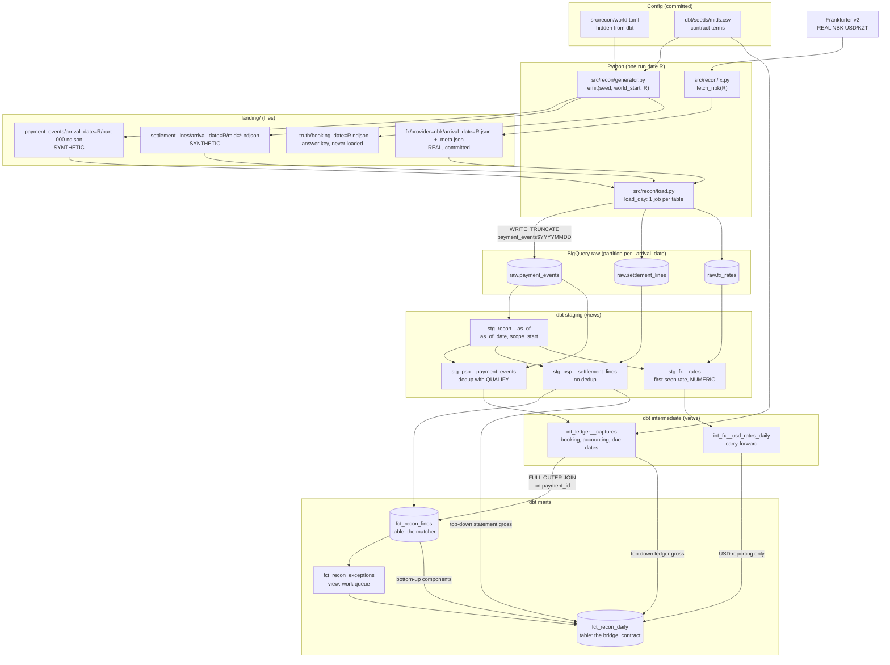
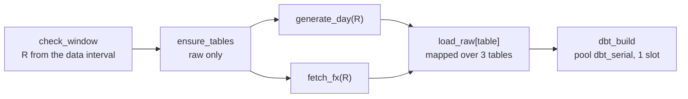

Study guide written by an AI agent in build mode from the code and docs/build_journal.md.

# Walkthrough: Two Ledgers (`ledger-vs-statement`)

This is the study guide for the finished v1.0 floor. Read it top to bottom once, then use the drill at the end to test yourself. Every `path:line` reference points at the code as it is on `main` after S10.2. Every measured number is copied from a file under `docs/evidence/`. Payments are synthetic. FX rates are real.

How to use it:

1. Read "The problem and the results" and "The architecture" first. They are the two-minute answer to "what is this?".
2. Read "File by file, in the order the data flows" with the code open next to it.
3. Read "Design decisions and their alternatives" and "Concepts, each tied to its file" before any interview.
4. Do the drill without notes. Check your answers against the model answers.

The step-by-step history, with the real command output of each step, is in `docs/build_journal.md`. Definitions of every term are in `docs/learning/concepts.md`.

## The problem and the results

**The question.** Does yesterday's revenue match what the payment service provider (PSP) settled, per merchant account (MID)?

**Why the two ledgers disagree even when nothing is wrong.**

- The revenue ledger books a sale from the PSP's payment webhook, on the UTC date of the capture.
- The PSP books the same sale on its own accounting date, on the MID's fixed clock (UTC+5 for `mid_kzt_01`, UTC-5 for `mid_usd_01`), and puts it on a statement that arrives 1 or 2 days later.
- So a sale near midnight lands on different days in the two ledgers, and a sale from yesterday is often not on any statement yet.

**What can really be wrong.** These are the planted defects in the "Defect catalog" of `docs/specs/data_and_generator.md`:

| Id | What happens | Expected outcome |
|---|---|---|
| D1 | a webhook is delivered more than once | removed by dedup, counted in `copies_received`, no exception |
| D2 | a payment is never settled | `in_transit` until its due date, then `missing_in_statement` |
| D3 | every webhook delivery of a settled payment is lost | `missing_in_ledger` |
| D4 | the settled gross differs from the booked amount | `amount_mismatch` |
| D5 | the fee is above the contract fee | `fee_mismatch` when above the tolerance |
| B1 | benign: the cut-off moves the accounting date | `matched` with `date_shift = timing_cutoff` |
| B2 | benign: the statement comes 1 or 2 days later | `in_transit`, then `matched` |
| B3 | benign: small fee noise | inside the tolerance, with rare designed spikes |

**What the pipeline does.** One Airflow 3 run per UTC arrival day loads that day into BigQuery with one load job per table and no DML. dbt then deduplicates the webhooks, matches every payment across the two ledgers on `payment_id`, gives each line one status and dated reason codes, and fails the run if any MID-day has a single unexplained minor unit.

**The results.** Copied from `docs/evidence/2026-11-02/summary.json` (written by `make results` at `2026-11-02 20:04:24+00:00`, `git_sha` `ae8e1a2eaaa09d5931794879cb225f3a7e9301fe`, seed `20261101`, world start `2026-10-04`, window `2026-10-03` to `2026-11-01`, as of `2026-11-01`, marts dataset `analytics`). N1 and N2 are measured on synthetic payments. N3 is measured on real NBK rates.

| # | Field in `summary.json` | Value |
|---|---|---|
| N1 | `summary` | "146 of 146 (table, partition) groups identical, 17595 rows, as_of 2026-11-01 in both" |
| N1 | `D_reprocessed_days`, `reprocess_from`, `reprocess_to` | 7 days, `2026-10-26` to `2026-11-01` |
| N1 | `cleared_day` (one older day, out of order) | `2026-10-14` |
| N1 | `P_identical` of `P_total`, `R_rows`, `identical` | 146 of 146, 17595, `true` |
| N2 | `M_mid_days` | 60 |
| N2 | `U_abs_unexplained_minor`, `days_not_closing` | 0, 0 |
| N2 | `assert_recon_decomposition_closes`, `claim_allowed` | `pass`, `true` |
| N2 | `K_caught` of `K_total` (the mutation check) | 4 of 4 |
| N2 | `first_day`, `last_day` | `2026-10-03`, `2026-11-01` |
| N3 | `C_carried_days`, `W_carried_days_differing` | 9, 9 |
| N3 | `X_max_abs_diff_kzt`, `X_day`, `Y_bps` | `5.82`, `2026-10-04`, `130.0` |
| N3 | `E_agreeing` of `E_own_rate_days` | 20 of 20 |
| N3 | `weekday_disagreements`, `days_without_nbk_rate` | `[]`, `[]` |

In plain words:

- **N1 (rerun proof, synthetic).** After 7 days were reprocessed and one older day was rerun out of order, every fingerprinted (table, partition) group was identical: 146 of 146, 17595 rows, with `as_of` 2026-11-01 in both snapshots. Source: `docs/evidence/2026-11-02/compare.json`.
- **N2 (cross-ledger identity, synthetic).** On all 60 MID-days, the gap between booked revenue and statement gross equals the sum of its dated reason components, with 0 minor units unexplained. The identity test passed in the DAG build that made the marts (`runs/dbt/2026-10-14/target/run_results.json`). 4 of 4 deliberate code mutations turned a test red (`docs/testing.md`).
- **N3 (real FX).** On 9 of 9 carried days (weekends), the project's carried-forward rate differed from NBK's own published rate, by up to 5.82 KZT per USD (130.0 bps), on 2026-10-04. On 20 of 20 days with their own published rate, the two sources agreed exactly. Source: `docs/evidence/2026-11-02/fx_report.json`.

What the numbers do not prove is in the README, heading "What this does not prove". The short version: this is a learning project on synthetic payments at a small volume. The identity shows that no minor unit is lost, duplicated or put on the wrong day. It does not show that every line got the right reason.

## The architecture

### The data flow, from the generator to the marts



Read the diagram from top to bottom:

1. **Config.** `world.toml` holds what finance does not know (volumes, defect rates, noise). `mids.csv` holds what both sides know (cut-off offsets, settlement lag, fees, tolerances). Only `mids.csv` reaches dbt, as a seed.
2. **Python, one run date R.** The generator writes the synthetic files that arrived on R. `fetch_nbk` lands the real NBK rates for R-6 to R, once. The loader makes exactly one write per raw table for R.
3. **Raw.** Each raw table is partitioned by `_arrival_date`. Each run owns one partition per table.
4. **Staging.** `stg_recon__as_of` reads "today" from the data: the newest loaded arrival day. The other staging views keep only rows up to that day, deduplicate the webhooks and cast the FX text to NUMERIC.
5. **Intermediate.** `int_ledger__captures` adds the three dates the matcher needs. `int_fx__usd_rates_daily` gives every calendar day a rate.
6. **Marts.** `fct_recon_lines` is the matcher. `fct_recon_exceptions` is the analyst queue. `fct_recon_daily` is the bridge per MID-day.

The one edge to remember: `fct_recon_daily` reads the gap **top-down** from `int_ledger__captures` and `stg_psp__settlement_lines`, which never pass through the matcher, and the components **bottom-up** from `fct_recon_lines`. That is why the identity test can fail (ADR-0003).

### One run of `recon_daily`



The order is in `dags/recon_daily.py:139-146`. A run for R has the data interval [R 00:00, R+1 00:00) UTC and starts after R+1 00:00 UTC.

### Where things run

| Piece | Where | Reads | Writes |
|---|---|---|---|
| Airflow 3.3.2 | Docker, image `ledger-vs-statement-airflow:3.3.2` | `landing/`, the read-only key mount | `raw`, `analytics`, `landing/`, `runs/` |
| dbt in Airflow | `/opt/airflow/dbt_venv/bin/dbt`, target `airflow` | `raw` | `analytics` |
| Host CLI and `make dbt-build` | the uv venv, target `dev` | `raw_dev` | `raw_dev`, `analytics_dev` |
| Proof and result scripts | the host, `scripts/` | `raw`, `analytics` | `docs/evidence/<UTC date>/` |

All datasets are in the US multi-region: `raw`, `raw_dev`, `analytics`, `analytics_dev` and `probe`.

## File by file, in the order the data flows

Each file below says what it does, then walks through its important lines. Quoted line numbers are from the current files.

### `src/recon/world.toml` and `dbt/seeds/mids.csv`: the two config sources

`world.toml` is every synthetic design parameter, each with a comment. They are illustrative assumptions, not measurements.

- `world.toml:5` `generator_version = "1.0.0"`: written into every answer-key row. A deliberate change to the output bumps it and the golden hash in the same commit.
- `world.toml:6` `lookback_days = 5`: a run recomputes booking days R-5 to R.
- `world.toml:7` `statement_grace_days = 1`: must equal the dbt var of the same name. `tests/test_generator.py:190` checks it.
- `world.toml:34-40`: the defect rates, in basis points. dbt never sees them.

`mids.csv` holds the contract terms for the two MIDs: `statement_utc_offset_hours`, `max_settlement_lag_days`, `fee_bps`, `fee_fixed_minor`, `fee_tol_bps`, `fee_tol_min_minor` (`dbt/seeds/mids.csv:1-3`). Both the generator and dbt read it.

Why two files: if dbt could read the defect rates, the matcher could be fitted to the answer, and the planted data would prove nothing (ADR-0010).

### `src/recon/config.py`: config into frozen dataclasses

- `config.py:15-30` `Mid`: one merchant account. `tag` (`:28-30`) is the lowercase currency, used in readable ids such as `pay_20261025_kzt_00042`.
- `config.py:33-49` `World`: everything finance does not know.
- `config.py:59-62` `load_mids`: reads the CSV and casts the integer columns, so no fee term is ever a string or a float.
- `config.py:88-107` `check`: fails at load time if the hour weights are not 24 values, the plan lists differ in length, the plan weights do not sum to 100, two MIDs share a tag, or a currency has no price list.
- `config.py:110-116` `load_env`: reads `RECON_SEED`, `RECON_WORLD_START` and `RECON_LANDING_DIR`. Only the CLI and the DAG call it. The generator takes these as arguments, so tests never depend on `.env`.

### `src/recon/generator.py`: synthetic payments, statements and the answer key

The generator is a pure function of (seed, day number, MID, purpose). It uses the standard library only.

- `generator.py:23-25` `stream`: one `random.Random` per purpose, seeded with a string such as `seed|day_index|mid|n|purpose`. Python seeds a string through SHA-512, so the stream is the same in every process. A new purpose never shifts the draws of another.
- `generator.py:28-31` `draw_int` and `:34-42` `draw_weighted`: the only two draw helpers. Both call only `Random.random()`, the one method whose sequence Python keeps stable across versions, and turn the draw into an integer at once.
- `generator.py:47-48` `expected_fee_minor`: `(gross * fee_bps + 5000) // 10000 + fee_fixed_minor`, integer half-up rounding. `:51-52` `fee_tolerance_minor`: `max(fee_tol_min_minor, (gross * fee_tol_bps + 9999) // 10000)`, an integer ceiling. dbt uses the same formulas.
- `generator.py:71` `day_index = (day - world_start).days`: draws are keyed by the day number, never the calendar date. Moving `RECON_WORLD_START` moves the same world to new dates.
- `generator.py:98`: B1, the accounting date is the capture time moved by the MID's fixed offset. No random draw.
- `generator.py:102-106`: one `money` draw picks D2, D3, D4 or none with cumulative thresholds. So D2 and D3 never meet on one payment.
- `generator.py:114-129`: webhook deliveries. None for D3 (`:115`). D1 adds 1 or 2 extra copies (`:120-124`). Each delivery's `_arrival_date` is the UTC date of its `delivered_ts` (`:126`), so a redelivery can land in the next day's file.
- `generator.py:132-166`: the statement line. None for D2 (`:133`). The lag is 1 or 2 days (`:134`). D4 changes the gross (`:138-142`). D5 or B3 sets the fee variance (`:145-158`).
- `generator.py:168-174`: the answer-key row with the planted classes and the due date.
- `generator.py:180-197` `arrivals`: recomputes every payment booked on R-5 to R and keeps only rows whose `_arrival_date` is R (`:188`). No state is carried between runs.
- `generator.py:200-206` `write_ndjson`: sorted keys, compact separators, written to `<name>.tmp` and renamed with `os.replace`. A crash never leaves half a file.
- `generator.py:209-223` `emit`: writes the events file, one statement file per MID and the answer key for R. Refuses a run date before the world start (`:211-212`).

### `tests/test_generator.py`: the generator's guarantees

- `test_generator.py:19` `GOLDEN`: the sha256 over the four files of run date 2026-10-09 for generator 1.0.0. `test_golden_hash` (`:56`) turns red on any byte change.
- `test_rerun_is_byte_identical` (`:61`), `test_other_seed_differs` (`:69`): determinism.
- `test_rows_belong_to_their_run` (`:76`): every events row has `_arrival_date = R` and a `delivered_ts` on R.
- `test_each_row_in_exactly_one_file` (`:94`), `test_lookback_is_enough` (`:122`): no row is lost or duplicated across arrival files.
- `test_rows_match_schema` (`:152`): every row has exactly the fields of its schema JSON.
- `test_class_counts_within_loose_bounds` (`:171`): planted counts lie between 0.25 and 3 times their expected value. The generator is deterministic, so this never flickers.
- `test_grace_days_match_dbt` (`:190`).

### `src/recon/fx.py`: real NBK rates, landed once

- `fx.py:15-18` `fx_url`: requests R-6 to R from Frankfurter v2 with `providers=nbk`. Seven days always contain weekdays, so the answer is never empty only because of a weekend.
- `fx.py:21-39` `check_rates`: USD/KZT only, no date after R, strictly increasing dates, and only the first row may be dated before R-6 (`:35`). That first row is the carry-in: the last rate before a weekend start.
- `fx.py:53-56`: if the body and its meta file both exist, return `skipped` with no HTTP request. A landed day is never fetched again.
- `fx.py:57-58`: if only one of the two exists, fail and ask for the stray file to be deleted by hand.
- `fx.py:59-61`: never request a run date on or after today (UTC).
- `fx.py:65`: a 10-second timeout.
- `fx.py:70`: `json.loads(body, parse_float=str)`. A float never touches a rate.
- `fx.py:77-78`: the meta file is renamed first and the body last, because the body's final name is the "landed" signal.

### `src/recon/schemas/*.json`: the raw contract

One JSON file per raw table: name, description, labels, partitioning, clustering and fields. For example `payment_events.json:3` starts the description with "SYNTHETIC: generated by src/recon/generator.py", `:4` sets `data_origin=synthetic`, `:5` partitions by `_arrival_date`, and `:15` makes `amount_minor` an `INT64`. One file drives the table, the load job schema and the pytest, so the three cannot drift apart.

### `src/recon/bq.py`: the one BigQuery helper

- `bq.py:10-12` `host_client`: the project comes only from `GCP_PROJECT`, the location is US.
- `bq.py:15-28` `query`: every Python query goes through here and gets `maximum_bytes_billed=1_000_000_000` (`:18`).
- `bq.py:31-33` `rows`: reads results row by row. No pandas.

### `src/recon/load.py`: one write per (table, day)

- `load.py:25-41` `ensure_tables`: creates the dataset in US and the three tables from their schema JSON with `exists_ok=True` (`:40`).
- `load.py:44-53` `check_same_shape`: `exists_ok=True` never changes an existing table, so the live table is read back and compared: partition field and type, clustering and columns. Any difference fails loudly. `:13` maps the legacy type names the API returns (`INTEGER`) to standard names (`INT64`).
- `load.py:60-70` `check_run_date`: the one guard on run dates, shared by the CLI and the DAG. It refuses a date before the world start, a date that has not ended in UTC, and a date older than `MAX_RUN_AGE_DAYS = 45` (`:14`).
- `load.py:75-79` `read_ndjson`: a missing expected file is an error, not an empty day.
- `load.py:82-95` `fx_rows`: checks the body's sha256 against the meta file (`:88`), parses with `parse_float=str` (`:90`), and copies `fetched_at` from the frozen meta file, so a reload writes the same row.
- `load.py:98-107` `landed_rows`: statement file names come from `mids.csv`, never from a glob (`:103`).
- `load.py:110-120` `load_day`: every row must have `_arrival_date = R`, and every payment event `DATE(delivered_ts) = R`, before any job runs (`:114-119`).
- `load.py:123-142` `load_partition`:
  - `:125` the destination is the partition decorator `<table>$YYYYMMDD`;
  - `:126-128` on an empty day, delete that partition, a table operation and not DML;
  - `:133` `WRITE_TRUNCATE`: replace that one partition with what this job loads;
  - `:134` `CREATE_NEVER`: a missing table fails loudly instead of being created without partitioning;
  - `:135` `max_bad_records=0`;
  - `:139-140` `job.output_rows` must equal the rows landed.

### `src/recon/cli.py`: the host CLI

- `cli.py:9-16` `guarded`: runs `check_run_date` with today's UTC date before anything is generated, fetched or loaded (`:15`). The wall clock is read only to check.
- `cli.py:58-66` `day`: generate, fetch, load: the same order as the DAG. `load` writes to `$RAW_DATASET`, which the Makefile sets to `raw_dev` (`Makefile:4`).
- `cli.py:69-78` `days`: one client, oldest first, the loop in Python (`:76`).

### `dags/recon_daily.py`: the daily pipeline

- `recon_daily.py:1-12`: the docstring states the interval rules. Read it once.
- `recon_daily.py:29-34` `DBT_BUILD_CMD`: the exact inline dbt command, with `--exclude-resource-type unit_test` and per-day `--target-path` and `--log-path` under `runs/dbt/{{ data_interval_start | ds }}/`.
- `recon_daily.py:46-51` `_bq_client`: `BigQueryHook(..., use_legacy_sql=False, location="US")`, because the provider defaults to legacy SQL.
- `recon_daily.py:62` `CronDataIntervalTimetable("0 0 * * *", timezone="UTC")`, `:63` `start_date`, `:64` `catchup=False`, `:65` `max_active_runs=1`.
- `recon_daily.py:75-95` `check_window`:
  - `:79-80` no data interval: fail with "No data interval: create exact days with a one-day backfill";
  - `:82-83` the interval must be exactly one UTC day from 00:00;
  - `:85` the only wall-clock read in the DAG, and only to check the window;
  - `:91-93` the same `check_run_date` as the CLI, raised as `AirflowFailException` so it never retries;
  - `:94` logs `run_date=YYYY-MM-DD`, the line to read in the log.
- `recon_daily.py:97-104` `ensure_tables`: refuses any `RAW_DATASET` other than `raw` (`:99`).
- `recon_daily.py:114-123` `fetch_fx`: 3 retries with `retry_exponential_backoff=2.0`, a float multiplier, and `max_retry_delay` (`:115-118`).
- `recon_daily.py:125-129` `load_raw`, mapped over the three tables at `:144`.
- `recon_daily.py:131-137` `dbt_build`: a `BashOperator` in pool `dbt_serial` (`:134`) with `append_env=True` (`:135`) and 0 retries.
- Heavy imports (the hook, the `recon` package) sit inside the task functions, because the dag-processor parses the file often.

### `dags/smoke_bigquery.py`: the walking skeleton

A manual DAG (`schedule=None`) that proves the plumbing before any business logic. `:29-30` gets a client from the hook, `:31` takes yesterday from the wall clock (allowed only here, because it writes to `probe`, never to `raw`), `:46` loads one row into `probe.smoke$YYYYMMDD` with `WRITE_TRUNCATE`, and `:64` runs the container's dbt with `debug --target airflow`.

### `Dockerfile`, `docker/requirements-dbt.txt`, `docker-compose.yaml`

- `Dockerfile:5-7`: a second venv at `/opt/airflow/dbt_venv` with the three dbt pins, then `dbt --version` so a broken install fails the build. The comment at `:2-3` gives the reason: the Airflow 3.3.2 constraints pin `google-cloud-storage` and `pathspec` to versions dbt refuses.
- `docker-compose.yaml:80-86`: `RAW_DATASET: raw`, the seed, the world start, the landing path, `DBT_KEYFILE` as a container path, and the connection `AIRFLOW_CONN_GOOGLE_CLOUD_DEFAULT` with `key_path`.
- `docker-compose.yaml:96`: `./keys:/opt/airflow/keys:ro`, the key mounted read-only.
- `docker-compose.yaml:142`: the UI on `127.0.0.1:8083` only.
- `docker-compose.yaml:277`: `airflow-init` creates the pool `dbt_serial` with 1 slot.

### `dbt/dbt_project.yml`, `dbt/profiles.yml`, `dbt/models/staging/_sources.yml`, `dbt/seeds/_seeds.yml`

- `dbt_project.yml:19-24`: the vars `statement_grace_days`, `fx_max_carry_days`, `exception_share_warn`, `exception_min_count`, `gate_window_days`. `as_of_date` is never set here.
- `dbt_project.yml:27-37`: staging and intermediate are views, marts are tables, `on_schema_change: fail`. No incremental model, so no config can produce DML.
- `profiles.yml:7-8`: the key path and the project id come from environment variables. `:15` and `:27`: `maximum_bytes_billed: 1000000000` on both targets.
- `_sources.yml:5` and `:14`: `schema: "{{ env_var('RAW_DATASET', 'raw') }}"`. The host reads `raw_dev`, the DAG reads `raw`, from one project.
- `_seeds.yml:11` `fee_bps: INT64`: every seed column has an explicit type, so nothing is inferred as FLOAT64.

### `dbt/models/staging/stg_recon__as_of.sql`: "today" from the data

- `:1-11`: compile-time guards. Target `airflow` must read `raw` and never take the `as_of_date` var; target `dev` must read `raw_dev`.
- `:32` `max(a._arrival_date) as as_of_date`: the newest loaded arrival day.
- `:34` `min(a._arrival_date) as scope_start`: the oldest loaded arrival day.

Every status in the marts is judged against this `as_of_date`, so rebuilding the same data later gives the same answer, and a rerun of an old day never rolls the marts back.

### `dbt/models/staging/stg_psp__payment_events.sql`: dedup

- `:22` `where e._arrival_date <= a.as_of_date`: the as-of filter runs first.
- `:18` `count(*) over (partition by e.event_id) as copies_received`: window functions are computed before `QUALIFY` filters, so this counts every copy.
- `:23-26` `qualify row_number() over (partition by e.event_id order by e.delivered_ts, e.delivery_id) = 1`: keep the earliest delivery, with `delivery_id` as the tie-break so every build keeps the same copy.

### `dbt/models/staging/stg_psp__settlement_lines.sql` and `stg_fx__rates.sql`

- `stg_psp__settlement_lines.sql:1-3`: no dedup on purpose. A repeated statement line is a PSP defect and must fail the `unique` test on `line_id`.
- `stg_fx__rates.sql:12` `cast(f.rate_text as numeric) as rate`: the text is cast once, never parsed as a float.
- `stg_fx__rates.sql:17-20`: one row per rate date, the first-seen value, because the same rate date appears in several fetches (each fetch covers 7 days).

### `dbt/models/intermediate/int_ledger__captures.sql`: the ledger with its dates

- `:17` `booking_date`: the UTC date of the capture.
- `:18` `expected_accounting_date`: the capture time moved by the MID's offset, then its date.
- `:19-22` `due_date`: expected accounting date plus `max_settlement_lag_days` plus `statement_grace_days`.
- `:24-25` `left join` to `mids`: a payment with an unknown MID keeps its row with NULL dates, and the `not_null` tests fail. An inner join would drop it silently.

### `dbt/models/intermediate/int_fx__usd_rates_daily.sql` and `dbt/macros/to_usd.sql`

- `int_fx__usd_rates_daily.sql:28-43`: a date spine from the first rate date to `as_of_date`.
- `:51-52` `last_value(r.rate ignore nulls) over w` and the same for `rate_date`: a day without a published rate carries the last one forward and keeps its date.
- `:85` `carry_days`: day minus `rate_date`. `_intermediate.yml:67-70` bounds it by `fx_max_carry_days`, so a long gap in the feed fails the build.
- `:65-77`: USD identity rows with `units_per_usd = 1`.
- `to_usd.sql:5`: `round(cast(minor as numeric) / minor_per_major / units_per_usd, 2)`. The cast comes first, so nothing is INT64 / INT64, and there is one rounding stage.

The carry-forward is a project convention, not NBK's official rate for that day.

### `dbt/models/marts/fct_recon_lines.sql`: the matcher

- `:1-5`: a table partitioned by `recon_date`, clustered by `mid`.
- `:37-56` the `statement` CTE, with `where s.record_type = 'SALE'` at `:54`. The filter sits before the join. After a FULL OUTER JOIN, a ledger-only line has NULL statement columns, so the same filter there would drop exactly the lines the matcher exists to find.
- `:81-83` `full outer join statement as s on l.payment_id = s.payment_id`: an equality join on one exact key. Lines seen on one side only are kept. `has_ledger` and `has_statement` (`:64-65`) say which sides a line was seen on.
- `:108` `recon_date`: the booking date, or the capture date for a statement-only line.
- `:109-116` `match_status`, one per line, first true condition wins:
  - both sides: `matched`;
  - ledger-only and booked before `scope_start`: `before_scope`;
  - ledger-only and `as_of_date < due_date`: `in_transit` (the due date is inclusive);
  - ledger-only otherwise: `missing_in_statement`;
  - statement-only and captured before `scope_start`: `before_scope`;
  - statement-only otherwise: `missing_in_ledger`.
- `:117-122` `date_shift` for matched lines: `none` when the PSP's date equals the booking date, `timing_cutoff` when it equals the expected accounting date, `date_mismatch` otherwise.
- `:123-128` the amount difference and `is_amount_mismatch`: gross tolerance 0.
- `:138-141` the fee check: `div(gross * fee_bps + 5000, 10000) + fee_fixed_minor` and `greatest(fee_tol_min_minor, div(gross * fee_tol_bps + 9999, 10000))`, integers only.
- `:151-152` `abs(fee_variance_minor) > fee_tolerance_minor`: a variance equal to the tolerance is within it.
- `:190-200` `primary_reason`: the precedence of `dbt/seeds/reason_codes.csv`.
- `:202-205` `is_exception`, with `coalesce(..., false)` because `FALSE OR NULL` is NULL in BigQuery.

### `dbt/models/marts/fct_recon_exceptions.sql`: the work queue

- `:1` a view: it stores nothing and derives from the fingerprinted lines table (ADR-0008).
- `:30` out-of-scope lines never enter the queue.
- `:34-84` one `SELECT` per cause, stacked with `UNION ALL`. One line can give two rows, for example an amount difference and a fee overcharge. Positive means the ledger has more, or the PSP overcharged, so `missing_in_ledger` is negated (`:49`).
- `:102-104` joined back to the lines on `payment_id`, which is unique in `fct_recon_lines`.
- `:96` `age_days` against the loaded `as_of_date`, never the wall clock.

### `dbt/models/marts/fct_recon_daily.sql`: the two-calendar bridge

- `:20-31` `ledger_daily`: ledger gross by `booking_date`, straight from `int_ledger__captures`.
- `:33-47` `statement_daily`: statement gross by `accounting_date`, straight from `stg_psp__settlement_lines`.
- `:49-65` `bounds`: one `UNION ALL` column, not `LEAST(MIN(...), MIN(...))`, because `LEAST` returns NULL when any argument is NULL.
- `:67-78` `spine`: every MID times every day, so a quiet day shows zeros.
- `:80-142` `component_rows`, from `fct_recon_lines` only. L is the ledger amount on booking date a, S the statement gross on accounting date b:
  - matched: `amount_mismatch` = L - S on b (`:85-92`);
  - matched with a date shift: +L on a (`:96-104`) and -L on b (`:108-116`);
  - ledger-only: its status, +L on a (`:120-128`);
  - statement-only: its status, -S on b (`:132-140`).
- `:176-190` `exceptions_daily`: absolute amounts, so a +X break and a -X break on one day cannot cancel. `date_mismatch` is counted but not summed (`:186`).
- `:252` `gap_minor` and `:253-262` `unexplained_minor`: the gap minus the seven components.
- `:294-298` the USD columns, through `to_usd`, after summing.

`dbt/models/marts/_marts.yml:139-141` enforces the contract, and `:203` declares `unexplained_minor` as `int64` with `not_null`.

### `dbt/tests/`: the singular tests

A singular test is a SQL file that passes when it returns no rows.

- `assert_recon_decomposition_closes.sql:11` `where d.unexplained_minor != 0`. No tolerance.
- `assert_no_money_lost_between_layers.sql:92-96`: per MID, the count and sums of each input model equal the matcher's side. It catches a dropped same-day matched line with L = S, which adds 0 to the gap and so passes the identity.
- `assert_redeliveries_identical.sql:13-20`: every raw copy of an `event_id` agrees on its business fields. Keeping the first copy is only safe if they all agree.
- `assert_arrival_days_complete.sql:11` builds a spine from `scope_start` to `as_of_date`. Payments must arrive on every day. Statements must arrive for every MID on every day after the first (`:56`), because on the first loaded day a MID can rightly have nothing to settle yet.
- `warn_exception_share_7d.sql:1` `severity='warn'`; `:29-31` needs both a high share and a minimum count, with NUMERIC division.
- `warn_fx_restated.sql:1` `severity='warn'`; `:15` a rate date with more than one `rate_text`.

### `dbt/models/_unit_tests.yml`: UT1 and UT2

- UT1 `ut_captures_cutoff_both_directions` (`:4-33`): six captures on both sides of both cut-offs, KZT at `18:59:59`, `19:00:00` and `19:30:00` UTC and USD at `03:00:00`, `04:59:59` and `05:00:00` UTC, with the expected accounting and due dates.
- UT2 `ut_lines_status_and_date_shift` (`:35-70`): every parent mocked, `as_of_date` 2026-10-28 and `scope_start` 2026-10-20 (`:42`). `pay_a` in transit, `pay_b` missing on its due date (the inclusive boundary), `pay_c` matched with a cut-off shift, `pay_d` matched with an unexplained date, `pay_e` statement-only in scope, `pay_f` statement-only before scope. Each statement row sets `record_type: SALE` (`:58-61`).

### `scripts/prove_idempotency.py`: the rerun proof

- `:17-26` `FINGERPRINT_SQL`: per (table, partition), `count(*)`, `bit_xor(farm_fingerprint(to_json_string(t)))` (`:20`) and `sum(cast(farm_fingerprint(to_json_string(t)) as bignumeric))` (`:21`).
- `:42-59` `snapshot`: the three raw tables by `_arrival_date`, the two mart tables by `recon_date`, plus the marts' `as_of_date` (`:51`). Tables are written as `<dataset>.<table>`, so the JSON never holds the project id.
- `:62-87` `compare`: passes only when no group changed, none is missing, none is new, and `as_of` is the same (`:72`). Exit code 1 otherwise.

### `scripts/results.py`, `scripts/fx_report.py`, `scripts/storage.py`

- `results.py:16` `PROOF`: the reprocessed range and the cleared day of S8.2.
- `results.py:17-23` `N2_SQL`: the N2 query on `fct_recon_daily`.
- `results.py:26-34` `mutation_counts`: K of K from the table in `docs/testing.md`.
- `results.py:37-42` `decomposition_status`: the status of `assert_recon_decomposition_closes` from the newest DAG `run_results.json` (`:39`), not the host's.
- `results.py:65` `claim_allowed`: U is 0 **and** the identity test passed in that build.
- `results.py:87`: the project id becomes `<project>` before the file is written.
- `fx_report.py:27-40` `fetch_rss`: the landed XML, or one request; never a date on or after today (`:32`).
- `fx_report.py:43-56` `usd_rate`: the XML must echo the requested date (`:49`), USD must be quoted per 1, and the rate is a `Decimal` (`:55`).
- `fx_report.py:93` own-rate days are `carry_days == 0`; `:95` any disagreement on them makes the script exit 1 (`:116`).
- `storage.py:11`: stored bytes now, a lower bound on the lifetime quota. Never a headline.

### `Makefile`: the entry points

- `Makefile:1-12`: reads `.env`, then sets host-only values: `RAW_DATASET := raw_dev`, the landing path, `DBT_PROFILES_DIR`, `DBT_KEYFILE`, `GOOGLE_APPLICATION_CREDENTIALS`. `RAW_DS ?= raw` and `MARTS_DS ?= analytics` for the proof scripts.
- `Makefile:16-21` `doctor`: fails unless `uv run dbt --version` shows Core 1.12.6 and bigquery 1.12.1, then checks the pool.
- `Makefile:35-36` `check`: lint and test, and fails if git tracks `keys/` or `.env`.
- `Makefile:62-66` `dbt-build`, `dbt-unit`: `uv run dbt` on target `dev`, never a bare `dbt`.
- `Makefile:74-88`: `backfill-dry`, `backfill` (`--run-backwards --max-active-runs 1`), `reprocess` (`--reprocess-behavior completed`), `clear-day`.
- `Makefile:90-105`: `snapshot`, `compare`, `results`, `storage`, `fx-report`.

## Design decisions and their alternatives

ADR-0001 to ADR-0003 are Accepted (S10.2). ADR-0004 to ADR-0010 are still Proposed drafts. The index is `docs/adr/README.md`.

| Decision | Rejected alternative, and why | ADR |
|---|---|---|
| The BigQuery sandbox, no billing, a design with no DML | a free trial (a card, a time limit), a paid account (overage is billed), other warehouse trials (they expire, delete data, or are not BigQuery), a local engine (not a cloud warehouse) | [ADR-0001](adr/0001-warehouse-bigquery-sandbox.md) |
| One `WRITE_TRUNCATE` load job per (table, arrival day) into `table$YYYYMMDD`; a partition delete on an empty day | `MERGE`, streaming inserts, Cloud Storage (refused or need billing); `WRITE_APPEND` plus dedup views (each rerun adds a copy); daily shard tables (the fallback if probe P3 had failed) | [ADR-0002](adr/0002-raw-write-path-and-time-model.md) |
| Raw partitioned by arrival date | by booking date: late data would rewrite old partitions | [ADR-0002](adr/0002-raw-write-path-and-time-model.md) |
| `as_of_date` = the latest loaded arrival date, stored on every mart row | a `run_date` var (an old rerun rolls the marts back) or `CURRENT_DATE()` (a different answer each day) | [ADR-0002](adr/0002-raw-write-path-and-time-model.md) |
| Exact match on `payment_id`, one status per line plus flags, dated additive components | MID-day totals only (no cause per payment); one reason from thresholds (hides a second cause); compare in USD (sub-cent residuals) | [ADR-0003](adr/0003-reconciliation-method.md) |
| The identity computed two independent ways, as an error test with no tolerance | an identity checked against its own residual: a tautology that can never fail | [ADR-0003](adr/0003-reconciliation-method.md) |
| An integer fee tolerance per MID, inclusive | a fixed 1-unit tolerance (ignores amount and currency) | [ADR-0003](adr/0003-reconciliation-method.md) |
| Frankfurter v2 with provider `nbk`, stored as published, landed once and committed | blended rates (mixed sources); fetching again every run (a restated rate breaks the rerun proof); FLOAT64 rates (binary rounding) | [ADR-0004](adr/0004-fx-policy.md) |
| The weekend carry-forward, labelled a convention and measured by N3 | NBK RSS as the primary source (XML per day, a guard for future dates); left for U7 to decide on evidence | [ADR-0004](adr/0004-fx-policy.md) |
| `CronDataIntervalTimetable("0 0 * * *", timezone="UTC")`, catchup off | `"@daily"` or a cron string (in Airflow 3 they give an empty data interval) | [ADR-0005](adr/0005-orchestration-and-run-semantics.md) |
| Exact days only through one-day backfills; history newest first | a UI, REST or CLI trigger (the interval comes from the trigger time); `catchup=True` or oldest first (early runs see a gap) | [ADR-0005](adr/0005-orchestration-and-run-semantics.md) |
| A 1-slot pool `dbt_serial` plus `max_active_runs=1` | `max_active_runs` alone (backfills are limited separately) | [ADR-0005](adr/0005-orchestration-and-run-semantics.md) |
| Retries by task type: 0 for deterministic tasks, 3 with backoff for the HTTP fetch | one retry policy for all (deterministic failures only wait longer) | [ADR-0005](adr/0005-orchestration-and-run-semantics.md) |
| A `BashOperator` calling dbt in its own venv | dbt in Airflow's environment (the pins conflict); a task per model (new tooling under time pressure); a container per run | [ADR-0006](adr/0006-dbt-runtime-in-airflow.md) |
| The answer key in local files only, never loaded into BigQuery | the key in BigQuery behind a guarded model (one wrong `ref` leaks it) | [ADR-0007](adr/0007-evaluation-and-answer-key.md) |
| Views for staging and intermediate, small full-rebuild tables for marts, no incremental model | `merge` incrementals and snapshots (they run `MERGE`); tables for staging (use the quota) | [ADR-0008](adr/0008-materialization-and-incremental.md) |
| `fct_recon_exceptions` is a view | a table (a second stored copy of data the lines table holds) | [ADR-0008](adr/0008-materialization-and-incremental.md) |
| A world from 2026-10-04 ending yesterday (UTC), a 45-day write guard | a longer window (old partitions expire before reruns); no guard (rows dated past expiry vanish with no error) | [ADR-0009](adr/0009-window-and-expiry.md) |
| A standard-library generator, one stream per purpose, keyed by `day_index`, emitted by arrival date | a data-faking library (no defects, no answer key); one stream per day (a new draw reshuffles everything); keyed by date (a moved window changes every row) | [ADR-0010](adr/0010-synthetic-world-design.md) |

Smaller decisions that live in the code, not in an ADR:

- Statement lines are not deduplicated (`stg_psp__settlement_lines.sql:1-3`): a duplicate must fail a test, not vanish.
- The `SALE` filter sits before the join (`fct_recon_lines.sql:54`): after the join it would drop the ledger-only lines.
- `LEFT JOIN` to `mids` (`int_ledger__captures.sql:24`): an unknown MID fails a test instead of disappearing.
- The DAG and the CLI share `check_run_date` (`load.py:60`): the two can never disagree about the window.
- One statement load job per day joins all MID files (`load.py:103`): two `WRITE_TRUNCATE` jobs into one partition would leave only the last MID.
- `fx_carry_days` is not wrapped in `COALESCE(..., 0)` (`fct_recon_daily.sql:218`): a 0 next to a NULL rate would claim a fresh rate that does not exist. The S5.6 journal entry records this as a deliberate deviation for the owner.

## Concepts, each tied to its file

Each concept has a card in `docs/learning/concepts.md` under the heading named.

### Partitions and partition decorators

A partition is the slice of a table for one value of its partition column, here one `_arrival_date` per day. The decorator `table$YYYYMMDD` names one partition as the target of a load job. Used in `load.py:125` (the destination) and `schemas/payment_events.json:5` (the partitioning). Probe P3 proved that a load into `$<yesterday>` left the other day untouched, and P4 proved that a row for another day is refused with "Some rows belong to different partitions rather than destination partition" (`docs/evidence/2026-11-01/g0_probe.json`). Cards: "Partitions and partition pruning", "Partition decorators".

### WRITE_TRUNCATE loads

`WRITE_TRUNCATE` replaces the whole target with what one job loads. With a decorator, the target is one partition. That is why `load_day` reads every expected file for the day and makes exactly one write (`load.py:110-142`), and why an empty day needs a partition delete (`load.py:126-128`): a load with no rows is not run at all, so stale rows would stay. Card: "Load jobs and write dispositions".

### Idempotency

Running a day twice gives the same state as running it once. Four pieces make it true here:

1. The generator writes byte-identical files for the same inputs (`generator.py:200-206`, `test_golden_hash`).
2. FX is landed once and never fetched again (`fx.py:53-56`), and `fetched_at` comes from the frozen meta file (`load.py:94`).
3. Each raw write replaces one partition (`load.py:133`).
4. Marts are full rebuilds as of `max(_arrival_date)` (`stg_recon__as_of.sql:32`), never the wall clock.

N1 measured it: 146 of 146 groups identical, 17595 rows. Cards: "Idempotency", "The fingerprint proof".

### Data intervals and backfills

A run's data interval is the slice of time it processes. `CronDataIntervalTimetable("0 0 * * *", timezone="UTC")` (`recon_daily.py:62`) gives [R 00:00, R+1 00:00) UTC. The run starts after the interval ends, so the run id shows R+1 while the logical date is R. `check_window` turns the interval into R (`recon_daily.py:75-95`).

Three verbs, never mixed up:

- **backfill**: create runs for a range (`Makefile:78-80`, newest first);
- **reprocess**: rerun days that already finished (`Makefile:82-84`, `--reprocess-behavior completed`);
- **clear**: rerun tasks of an existing run (`Makefile:86-88`).

Cards: "Data interval", "Timetables: CronTriggerTimetable vs CronDataIntervalTimetable", "Backfill, reprocess and clear (the three verbs)".

### Dedup with `QUALIFY`

`QUALIFY` filters on a window function, the way `HAVING` filters on an aggregate. `stg_psp__payment_events.sql:23-26` keeps `row_number() = 1` per `event_id`, ordered by `delivered_ts` then `delivery_id`. The tie-break makes the kept copy the same on every build, which the rerun proof needs. Mutation 3 removed the clause, and the uniqueness tests at every layer and both money tests turned red (`docs/testing.md`). Card: "Deduplication with QUALIFY".

### The FULL OUTER JOIN matcher

A `FULL OUTER JOIN` keeps rows from both sides, with NULLs where one side has no match. `fct_recon_lines.sql:81-83` joins on `l.payment_id = s.payment_id`. BigQuery refuses a FULL OUTER JOIN without an equality, and an `OR` condition could match one line to several, breaking the grain. Mutation 1 (INNER JOIN) and mutation 4 (the `SALE` filter after the join) were both caught by the identity and preservation tests. Card: "FULL OUTER JOIN matching".

### Integer money

Every amount is an `INT64` number of minor units (cents, tiyn), end to end. Fees use `//` in Python (`generator.py:47-52`) and `DIV` in SQL (`fct_recon_lines.sql:138-141`): `+ 5000` then divide by 10000 rounds half up, `+ 9999` then divide is a ceiling. No `/` between two INT64 values (the result would be FLOAT64), no `POW()`, no `ROUND(x * bps / 10000)`. USD columns cast to NUMERIC before dividing (`to_usd.sql:5`). Cards: "Data types for money: INT64, NUMERIC and FLOAT64", "Minor units and integer fee arithmetic".

### FX carry-forward

The Frankfurter series has no row for weekend days. `int_fx__usd_rates_daily.sql:51-52` fills a day without a rate with the last published one and keeps its `rate_date`. It is a project convention, not NBK's official rate for that day. N3 measured the convention against NBK's own feed: on 9 of 9 carried days they differed, by up to 5.82 KZT per USD (130.0 bps). In `fx_report.json`, Saturday 2026-10-24 has `nbk_rate` `451.05` and `project_rate` `447.94` (carried from `rate_date` 2026-10-23), and Monday 2026-10-26 has `451.05` from both sources. Card: "FX rates, direction, cross rates and the carry-forward".

### dbt tests

- **Generic tests** in YAML (`unique`, `not_null`, `accepted_values`, `relationships`, `dbt_utils.*`), for example `_staging.yml:63-65` checks `net_minor = gross_minor - fee_minor`.
- **Singular tests** in `dbt/tests/`: pass when they return no rows.
- **Severity**: the two `warn_*` tests only warn, because a bad business day is work for an analyst, not a broken pipeline. The identity, preservation and completeness tests are errors.

Card: "Data tests: generic, singular and severity", "Data quality checks: integrity gates and business gates".

### Unit tests

A dbt unit test runs one model's SQL on fixed input rows and compares exact output rows (`dbt/models/_unit_tests.yml`). UT1 and UT2 were written first and seen red on a naive model (`72d7ad3`, `8ed9fe6`), then green (`4c131b9`, `74fb5d8`), as recorded in "Planned red runs (not bugs)" in `docs/failure_log.md`. Unit tests run only on the host: the DAG passes `--exclude-resource-type unit_test` (`recon_daily.py:31`). Mutation 2 (`<` to `<=` in the in-transit rule) was caught only by UT2, because the dev data had no line exactly on its due date. Cards: "Unit tests", "Unit tests versus data tests".

### Contracts

An enforced contract lists the exact columns and types a model must return. dbt checks them before it builds the table. `_marts.yml:139-141` enforces it on `fct_recon_daily`. In S7.3 a deliberate change of `unexplained_minor` to `string` stopped the build at compile time with "data type mismatch", and the old table stayed in place. BigQuery enforces only `not_null`, so uniqueness stays a data test. Cards: "Contracts", "Data contracts".

## How it was built

### The milestones, in order

| Milestone | What was built | Key commits |
|---|---|---|
| M0 Design-first repo | `.gitignore` first, the private banned-word hook, the design and the defect catalog before any code | `60a031c`, `d2cb9ff`, `231d97e` |
| M1 G0 sandbox probes | the sandbox project and key (owner), the uv project, `scripts/g0_probe.py`; all probes P1 to P7 and F1 passed on 2026-11-01 | `dbae9d5`, `4bebb6e`, `61f9d3b` |
| M2 Walking skeleton | the image with the dbt venv, the compose file, the raw schema contract, `smoke_bigquery`; gate G-skel passed | `03600ec`, `feca6a5`, `f7bc8ec`, `abc035b` |
| M3 Generator | `world.toml`, `config.py`, the generator, its tests, `make day` with byte-identical output | `bb29c89`, `75cd6cd`, `c17f4db`, `1dae889` |
| M4 Loader and FX | `load_day` and `load_partition`, `fetch_nbk`, the host CLI | `3ce0221`, `57822b1`, `a33593f` |
| M5 dbt core | seeds and sources, staging, UT1 then `int_ledger__captures`, the FX spine, UT2 then the matcher, the daily bridge and its integrity tests | `81aac5e` to `6c97a10` |
| M6 DAG end to end (G1) | `recon_daily`, the first real run, the tag `g1-freeze`, the history backfill newest first | `ebdff8e`, `050b7d2`, `9fe1bdd` |
| M7 dbt complete | the exception queue, the contract check, the completeness and warning tests, mutations 1 to 4, the final marts rebuilt | `6693bc5`, `c6cba6c`, `e2e919d`, `f0712cb` |
| M8 Rerun proof | the fingerprint script, then the proof run | `d3042f1`, `ae8e1a2` |
| M9 Results | `summary.json`, `storage.json`, the NBK cross-check | `9b3fabd`, `8441208`, `09a2585`, `52c353d` |
| M10 Publish | the README first screen (S10.1), ADR-0001 to 0003 accepted (S10.2), the clean-clone check (S10.3, no commit) | `5b19df0`, `60a4aa3` |

S10.4 (the name review, making the repo public, the description, the topics and the tag `v1.0`) is owner-only and is not done by this guide.

### The real bugs, from `docs/failure_log.md`

There is one entry:

- **F-001: the pre-push hook was installed with the wrong lines of the plan** (S0.2, area `setup`). The install copied the hook out of `docs/build_plan.md` by fixed line numbers after the plan had shifted by two lines. The hook started with two Markdown lines and lost its last two lines, so it failed with `.git/hooks/pre-push: line 1: -: command not found` and `exit=2`. The hook fails closed, so this could only block pushes, never let a word through. The fix was to extract the hook between its code-fence markers. Lesson: copy text out of a document by its markers, never by line numbers.

Not bugs, but worth knowing (from `docs/build_journal.md`):

- The planned red runs of UT1 and UT2 are recorded in "Planned red runs (not bugs)" in `docs/failure_log.md`. The UT2 row first named the wrong rows; a dated correction was appended below the table.
- Lint findings fixed on the spot: UP017 (`datetime.UTC`), FURB122 (`writelines`), RUF007 (`itertools.pairwise`). BLE001 in `scripts/g0_probe.py` was kept on purpose with a `noqa` and a reason.
- Record slips: the G0 evidence file went into the S2.1 commit `03600ec`; the S2.5 Makefile targets went into the S2.3 commit `f7bc8ec`; the `fct_recon_daily` contract shipped early in S5.6 (`6c97a10`), so S7.3 is the empty commit `c6cba6c` that records the check; the S5.1 to S5.5 journal entries were written late; `docs/testing.md` gave a local date, and a UTC correction was appended.
- A date shift, not a deviation: the first real run (S6.2) happened on 2026-11-02, so unpausing created the run for 2026-11-01, and the backfill covered 2026-10-04 to 2026-10-31.

### What was cut, and why

Nothing was cut. The cut order in `docs/build_plan.md` ("Cut order and the slip rule") was never needed: N3 was built, both warning gates exist, `load_raw` stays mapped, the full history was backfilled, `fct_recon_exceptions` is a view, `fetch_fx` is a live task, and the fee checks are in. Mutation 5, the seeded self-test and the upgrades U1 to U7 are later milestones, not cuts.

## How to run it from a clean clone

The owner-only parts (the Google Cloud console, the key, making the repo public) are marked. Never write the project id anywhere but `.env`.

### The clean-clone check (S10.3)

This writes nothing to BigQuery. It shows that a stranger's clone installs, tests, parses and builds.

```sh
CC="$(mktemp -d)" && cd "$CC"
gh repo clone <owner>/ledger-vs-statement && cd ledger-vs-statement
cp .env.example .env                       # fill in GCP_PROJECT and AIRFLOW_UID
make setup && make check
(cd dbt && DBT_PROFILES_DIR="$PWD" GCP_PROJECT=ci-dummy RAW_DATASET=raw_dev DBT_KEYFILE=/nonexistent/sa.json uv run dbt parse)
docker compose build
cd ~/Developer/ledger-vs-statement && rm -rf "$CC"
```

The clone has no pre-push hook and no key. That is expected. Never push from it.

### A full run

1. **Owner, in the console:** a sandbox project with no billing account, a dataset `probe` in US, the service account `lvs-pipeline` with BigQuery Job User and BigQuery Data Editor, its JSON key saved as `keys/sa.json`, then `chmod 600 keys/sa.json`. Screen-by-screen steps are in `docs/specs/bigquery_sandbox_and_costs.md`.
2. `make setup`, then edit `.env`: `AIRFLOW_UID`, `GCP_PROJECT`, `RECON_SEED=20261101`, `RECON_WORLD_START`. Pick the world start with "The window rule" under "Run it in full" in `README.md`: every run date must be at most 45 days old.
3. `make probe` (all PASS), then `make bq-setup`.
4. `make up`, then `make doctor` (dbt 1.12.6 and bigquery 1.12.1 on the host, and the pool) and optionally `make smoke`.
5. `make unpause`: with catchup off, the scheduler runs the latest complete UTC day. Read `run_date=` in the `check_window` log.
6. `make backfill-dry FROM=<world start> TO=<the day before that run>`, then `make backfill` with the same dates. It runs newest first.
7. Wait until `airflow dags list-runs recon_daily --state running` and `--state queued` show nothing, and no run failed.

### Rerun the proof

The procedure is "N1: rerun proof" in `README.md`. In short, all inside one UTC day, with the code frozen and nothing running:

```sh
make snapshot OUT=docs/evidence/<UTC date>/fp_before.json FROM=<world start minus 1 day> TO=<latest day>
make reprocess FROM=<latest day minus 6 days> TO=<latest day>
make clear-day DAY=<one older day>          # after all reprocess runs are green
make snapshot OUT=docs/evidence/<UTC date>/fp_after.json FROM=<world start minus 1 day> TO=<latest day>
make compare BEFORE=docs/evidence/<UTC date>/fp_before.json AFTER=docs/evidence/<UTC date>/fp_after.json
make fx-report
make results
```

Rules while it runs:

- Use a new `docs/evidence/<UTC date>/` folder. Never edit `docs/evidence/2026-11-02/`.
- The snapshot range starts one day before the world start, because a USD accounting date can fall there.
- After the next 00:00 UTC, a scheduled run would legitimately change the marts and `as_of`, so the two snapshots must be taken inside one UTC day.
- Never pause the DAG, stop the stack or change code while the proof runs.
- If `make compare` exits non-zero, that is a finding for `docs/failure_log.md`. Find the cause, fix it and rerun the whole procedure from a new `fp_before.json`.
- `make results` reads `compare.json` and `fx_report.json` from today's evidence folder, so run `make fx-report` before it.

## Drill

### 20 questions with model answers

1. **What question does the pipeline answer, and for whom?**
   Does yesterday's revenue match what the PSP settled, per MID? An analyst works the queue in `fct_recon_exceptions`, a finance lead reads `fct_recon_daily`, and the engineer on duty needs runs that fail loudly and rerun the same.

2. **Why does the project have no DML, and how does data get in?**
   The sandbox has no billing account and refuses every DML statement; probe P2's `INSERT` was refused with "DML queries are not allowed in the free tier" (`docs/evidence/2026-11-01/g0_probe.json`). Data goes in only through load jobs (`load.py:137`), a partition delete on an empty day (`load.py:127`), and dbt views and full-rebuild tables, which are DDL.

3. **What exactly does one run of `recon_daily` own?**
   One UTC arrival day R: the data interval [R 00:00, R+1 00:00) UTC. It writes one partition `$YYYYMMDD` per raw table and then rebuilds the marts from all loaded days.

4. **Why `CronDataIntervalTimetable` and not `"@daily"`?**
   In Airflow 3 a cron string or `"@daily"` becomes a `CronTriggerTimetable`, whose data interval is empty. `check_window` would refuse it (`recon_daily.py:82-83`). `CronDataIntervalTimetable` gives one UTC day ending at midnight.

5. **Why does a run for 2026-10-25 start on 2026-10-26, and which date is in its run id?**
   A run starts after its interval ends. The logical date is 2026-10-25, but the run id carries `run_after`, 2026-10-26. Read `run_date=` in the `check_window` log.

6. **How do you run one exact day, and what must you never use for it?**
   A one-day backfill, `--from-date D --to-date D`, after `--dry-run`. Never `airflow dags trigger -l D`: its interval comes from the trigger time, so it processes yesterday relative to now.

7. **Why load the history newest first?**
   `assert_arrival_days_complete` needs a payment partition on every day from `scope_start` to `as_of_date`. Newest first, each finished run extends a contiguous history downwards. Oldest first, after the latest day exists, would leave a hole.

8. **Why is `as_of_date` the latest loaded arrival day and not `CURRENT_DATE()`?**
   Statuses such as `in_transit` depend on it. With the wall clock, the same data rebuilt a day later would give different statuses, and the rerun proof would fail. With a `run_date` var, an old rerun would roll the marts back. `stg_recon__as_of.sql:32` reads it from the data.

9. **What does `check_run_date` refuse, and why 45 days?**
   A date before the world start, a date that has not ended in UTC, and a date more than 45 days old (`load.py:60-70`). The sandbox expires partitions 60 days after their date (P6: 5184000000 ms), and rows dated past that vanish right after a load with no error. 45 leaves a margin for reruns.

10. **Why one statement load job per day and not one per MID file?**
    `WRITE_TRUNCATE` replaces the whole partition with what one job loads. Two jobs into `settlement_lines$YYYYMMDD` would leave only the last MID's rows. `landed_rows` joins the MID files first (`load.py:102-104`).

11. **Why is the dedup ordered by `delivered_ts` and then `delivery_id`?**
    Two copies can share a `delivered_ts`. Without a unique tie-break, `ROW_NUMBER` could keep a different copy on each build, `first_delivery_id` could change, and the fingerprints would differ.

12. **Why are statement lines not deduplicated?**
    A repeated statement line is a PSP defect. It must fail `unique` on `line_id` and be investigated, not disappear (`stg_psp__settlement_lines.sql:1-3`).

13. **Why must the `SALE` filter sit before the join?**
    After a FULL OUTER JOIN, a ledger-only line has NULL statement columns, so `WHERE record_type = 'SALE'` would drop it. Mutation 4 moved the filter, and both money tests and UT2 turned red (`docs/testing.md`).

14. **A ledger-only KZT line has `due_date` 2026-10-28 and `as_of_date` is 2026-10-28. What is its status?**
    `missing_in_statement`. The due date is inclusive: `in_transit` only while `as_of_date < due_date` (`fct_recon_lines.sql:112`). This is `pay_b` in UT2. Mutation 2 changed `<` to `<=`, and only UT2 caught it.

15. **A KZT payment is captured at 19:00:00 UTC on 2026-10-20. Which accounting date does the PSP give it, and what is `date_shift` when it matches?**
    2026-10-21. 19:00 UTC plus 5 hours is midnight on the MID's clock. Its `date_shift` is `timing_cutoff`, because the PSP's date equals `expected_accounting_date` (`int_ledger__captures.sql:18`, `fct_recon_lines.sql:120`). 18:59:59 stays on the 20th (UT1, `pay_k1` and `pay_k2`).

16. **Why is `unexplained_minor` not a tautology?**
    The gap is top-down from `int_ledger__captures` and `stg_psp__settlement_lines` (`fct_recon_daily.sql:20-47`). The components are bottom-up from `fct_recon_lines` only (`:80-142`). A matcher that loses, duplicates or misdates a line, or uses a wrong sign, makes the two disagree. Mutations 1, 3 and 4 turned `assert_recon_decomposition_closes` red.

17. **Why do you need `assert_no_money_lost_between_layers` if the identity closes?**
    A matched same-day line with L = S adds 0 to the gap and 0 to every component. If the matcher dropped it, the identity would still close. The preservation test compares counts and sums per MID between each input and the matcher (`assert_no_money_lost_between_layers.sql:92-96`).

18. **How does the fee check avoid floats, and is a variance equal to the tolerance an exception?**
    `div(gross * fee_bps + 5000, 10000) + fee_fixed_minor` rounds half up, and `greatest(fee_tol_min_minor, div(gross * fee_tol_bps + 9999, 10000))` is a ceiling (`fct_recon_lines.sql:138-141`); Python uses the same formulas with `//`. A variance equal to the tolerance is within it: the test is `>` (`:152`).

19. **What do the fingerprints compare, and why three numbers per group?**
    Each (table, partition) group of the three raw tables by `_arrival_date` and the two mart tables by `recon_date`, plus the marts' `as_of_date`. `BIT_XOR` of row hashes does not depend on row order, but two identical rows cancel, so `COUNT(*)` and a BIGNUMERIC `SUM` of the same hashes are kept too (`prove_idempotency.py:17-26`). N1: 146 of 146 groups identical, 17595 rows.

20. **Which numbers are synthetic and which are real, and why is the carry-forward a convention?**
    N1 and N2 are measured on synthetic payments; N3 on real NBK rates (`summary.json`, fields `synthetic` and `real`). NBK publishes its own rate for weekend days (for example `451.05` for Saturday 2026-10-24, the same as Monday 2026-10-26), while the project carries Friday's rate (`447.94`) forward. On 9 of 9 carried days they differed, by up to 5.82 KZT per USD (130.0 bps). The reconciliation never converts currency, so this affects only the USD reporting columns.

### Five "explain this file without notes" exercises

For each exercise, close every file, explain the file aloud for about three minutes, then open it and tick the checklist. A point you missed is the one to study.

**Exercise 1: `src/recon/load.py`**

Say what it does, then cover:
- [ ] `ensure_tables` creates from the schema JSON and `check_same_shape` reads the table back, because `exists_ok=True` never changes an existing table.
- [ ] `check_run_date`: the three refusals and the 45-day reason; shared with the DAG.
- [ ] `read_ndjson`: a missing file is an error, a 0-byte file is an empty day.
- [ ] `fx_rows`: the sha256 check, `parse_float=str`, `fetched_at` from the meta file.
- [ ] `landed_rows`: MID file names from `mids.csv`, never a glob.
- [ ] `load_day`: every `_arrival_date` and `DATE(delivered_ts)` check runs before any job.
- [ ] `load_partition`: the decorator, `WRITE_TRUNCATE`, `CREATE_NEVER`, `max_bad_records=0`, the partition delete on an empty day, and `output_rows` equal to the rows landed.

Self-check: what would happen to a day whose rerun now has no rows, if the partition delete were missing?

**Exercise 2: `dbt/models/marts/fct_recon_lines.sql`**

- [ ] The CTE order: `as_of`, `ledger`, `statement` (with the `SALE` filter), `joined`, `with_terms`, `classified`, `fees`, `flagged`.
- [ ] The equality FULL OUTER JOIN on `payment_id`, and `has_ledger` and `has_statement`.
- [ ] The six `match_status` branches in order, and why `before_scope` comes before `in_transit`.
- [ ] The three `date_shift` values.
- [ ] The integer fee formulas and the inclusive tolerance.
- [ ] `primary_reason` follows the precedence in `reason_codes.csv`.
- [ ] Why `is_exception` needs `coalesce(..., false)`.

Self-check: which unit test row pins the inclusive due date, and which mutation proved it?

**Exercise 3: `dbt/models/marts/fct_recon_daily.sql`**

- [ ] The gap is top-down from the two input models; the components are bottom-up from the matcher.
- [ ] The spine (every MID times every day) and why the bounds use `UNION ALL` and not `LEAST`.
- [ ] The four kinds of component rows, with the signs and the dates (+L on a, -L on b, L - S on b, +L or -S for one-sided lines).
- [ ] `unexplained_minor` = gap minus the seven components; the test has no tolerance.
- [ ] Fees stay out of the identity.
- [ ] `exception_abs_minor` sums absolute values; `date_mismatch` is counted but not summed.
- [ ] USD columns come last, through `to_usd`, once per MID-day; the contract is enforced.

Self-check: a matched KZT line is booked on day a and accounted on day b with equal amounts. What does it add to day a, to day b, and to the window as a whole?

**Exercise 4: `dags/recon_daily.py`**

- [ ] The schedule, `start_date`, `catchup=False`, `max_active_runs=1`.
- [ ] `check_window`: the interval checks, the one wall-clock read, `AirflowFailException`, the `run_date=` log line.
- [ ] `ensure_tables` refuses any `RAW_DATASET` but `raw`.
- [ ] The retries by task type, and why `retry_exponential_backoff` is `2.0` with `max_retry_delay`.
- [ ] `load_raw` is mapped over three tables.
- [ ] `dbt_build`: inline command, `--exclude-resource-type unit_test`, per-day target and log paths, pool `dbt_serial`, `append_env=True`, 0 retries.
- [ ] Heavy imports inside the task functions.

Self-check: what does the pool `dbt_serial` stop, and what does it not stop?

**Exercise 5: `src/recon/generator.py`**

- [ ] `stream`: one stream per purpose, a string seed, keyed by `day_index`.
- [ ] Only `Random.random()`, through `draw_int` and `draw_weighted`.
- [ ] The integer fee formulas, the same as dbt.
- [ ] The order of draws in `one_payment`: plan, time, the `money` draw (D2, D3, D4), deliveries with D1, lag, D4 amount, D5 or B3.
- [ ] The accounting date from the fixed offset (B1), with no draw.
- [ ] `arrivals` recomputes R-5 to R and keeps only rows that arrived on R.
- [ ] `write_ndjson`: sorted keys, compact separators, temp file and rename; `emit` writes the answer key to `_truth/`, which is never loaded.

Self-check: why does moving `RECON_WORLD_START` give the same payments on new dates, and what changes?
